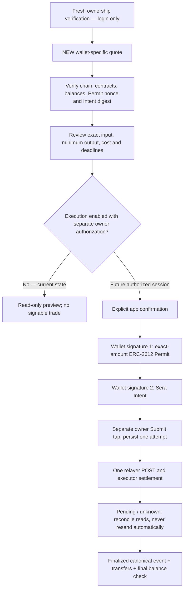

# Phase 7D — quote discovery and relayed authorization review

2026-09-17. **Read-only preparation; mainnet and swap execution OFF. No financial signature, swap submission or settlement has been performed.** The funding claim remains verified. This record supersedes the one-USDC liquidity blocker; it does not complete live swap acceptance.

## Observed liquidity envelope

Twenty sequential public quote requests ran at 07:29 UTC with one second between completed probes and existing client pacing. Token registry minimums were zero; both verified tokens have six decimals. All requests used the actual acceptance wallet as owner and recipient, exact raw input, a fresh server-time deadline and `receive_less`. Per-probe latency was approximately 1.15–1.59 seconds. Each failure was HTTP 400 with the exact legacy detail `No liquidity`; each success was HTTP 200 with a positive minimum output and one reported route leg. Private evidence retains individual timestamps, quote/Intent IDs, deadlines, gas breakdowns, exact allowlisted errors and latency. No signatures are in that evidence.

| Input in source token | USDC → XSGD minimum output | XSGD → USDC minimum output |
|---:|---:|---:|
| 0.01 | No liquidity | No liquidity |
| 0.1 | No liquidity | No liquidity |
| 0.5 | No liquidity | No liquidity |
| 1 | No liquidity | No liquidity |
| 2 | 0.411954 | No liquidity |
| 5 | 4.186565 | 2.327812 |
| 10 | 10.477582 | 6.300052 |
| 25 | 29.350635 | 18.216772 |
| 50 | 60.805722 | 38.077972 |
| 100 | 123.715896 | 77.800372 |

Classification: **B — EXECUTABLE_AT_LARGER_SIZE**. Select **2 test USDC → XSGD**, the smallest successful tested amount, below the experiment's 100-USDC hard cap. The read-only runtime check reports an unchanged 100-USDC configured maximum; the selected acceptance amount is still exactly two. This is neither an exact protocol minimum nor a liquidity promise. No fallback pair is needed. Reverse success is public quote evidence only; production execution remains restricted to USDC → XSGD.

At this observation, all successful quotes reported `gas_cost_usd=1.644426870045336000000`. Forward `gas_cost_from_token` was the same in USDC; reverse was `2.104451054365376370549178232` XSGD. These costs consume a substantial fraction of the two-USDC input. The input remains exactly two; the quote's minimum output already reflects its `receive_less` costs. Do not subtract costs again. A distinct expected fill is not supplied: display the verified minimum separately without inventing a guaranteed expected output. The common cost is consistent with an amount-specific constraint, but the API's internal cause is not established.

These matrix quotes expired and **must never be signed or promoted**. Recheck a newly requested two-USDC quote after fresh ownership for any eventual review/authorization. The ownership session was expired at discovery; reading public quotes did not refresh or impersonate it.

A separate new two-USDC quote at **07:51:37 UTC** passed the production quote validator and live Permit nonce/domain/Intent-digest checks. Minimum output was **0.207419 XSGD**, with quoted cost **1.803678237357282000000 USDC** (same USD reference), one reported leg, same-wallet recipient and expiry **07:52:08 UTC**. This differs materially from the earlier matrix and demonstrates why fresh review is mandatory. It is now historical evidence, not a pending wallet approval. No existing quote, ownership or financial session was reused.

## Repeatable bounded discovery

`npm run quotes:discover` reads the single allowlisted user's existing wallet reference through a read-only SQLite connection, verifies Sepolia/deployment/token contracts and performs the same matrix. `npm run quotes:discover -- --amount 2` reads one fresh forward quote. It requires execution OFF, permits only public quote/config/time/health/token API paths and has no trade sender, session issuer or financial mutation. It prints safe structured results, never raw provider errors. This is an operator diagnostic, not a user authorization or a background scanner. Do not repeatedly run the matrix to hunt liquidity.

`src/trades/discovery.ts` rejects over-cap amounts, duplicates, stale/mismatched terms and malformed responses. Requests are sequential, paced at least one second apart, and stop on rate limiting. It distinguishes `NO_LIQUIDITY`, `QUOTE_EXPIRED`, `RPC_ERROR`, `AUTH_ERROR`, `VALIDATION_ERROR`, other API failures and registry minimums. Incomplete/error matrices cannot establish pair-wide absence. A fallback selector is tested but not invoked here; it allows at most one funded, contract-verified USDC input candidate only after complete genuine no-liquidity evidence in both intended directions, and labels it `E2E_TEST_FALLBACK_PAIR` without enabling product support.

Classification A means the smallest successful sample is at or below the original one-USDC reference (a separate `referenceExecutable` flag records equality); B means above it; C means reverse only; D means genuine absence across the complete eligible range; E means incomplete/API/configuration evidence. No automatic amount changes are made to user intents.

## Verified execution architecture

Official sources inspected on 2026-09-17: [Sepolia swaps API](https://docs.testnet.sera.cx/api-reference/endpoints/swaps/), [SOR](https://docs.testnet.sera.cx/contracts/sor/), [API authentication](https://docs.testnet.sera.cx/api-reference/authentication/), [ERC-2612](https://eips.ethereum.org/EIPS/eip-2612), [SeraSOR source](https://github.com/sera-cx/orderbook-contract-v2/blob/audit/src/SeraSOR.sol), [SeraBase source](https://github.com/sera-cx/orderbook-contract-v2/blob/audit/src/SeraBase.sol). The upstream contract source was read for verification only; no contract source was copied. Its current SPDX notice is PolyForm-Noncommercial-1.0.0. Existing MIT attribution and historical research remain intact.

| Question | Verified behavior for this wallet-deposit path |
|---|---|
| Allowance / ordinary approval | SOR needs token spending authority. The quote requires ERC-2612 Permit, even if an existing allowance is reported. No separate `approve()` native transaction is prepared. |
| Permit type | EIP-712 `Permit(owner,spender,value,nonce,deadline)` under the exact USDC token domain; live token domain is `CIRCLE`, version `1`, Sepolia. |
| Permit scope | Exact selected raw input (2,000,000), never unlimited; SOR spender, current token nonce and token `DOMAIN_SEPARATOR()` verified. Its deadline limits submission of the signature; an allowance already activated does not automatically expire then. |
| Separate Intent | EIP-712 domain `Sera`, version `1`, chain 11155111, verifying contract Sera. Fields: `taker`, `inputToken`, `outputToken`, `maxInputAmount`, `minOutputAmount`, `recipient`, `initialDepositAmount`, numeric `uuid`, `deadline` (`uint48`). |
| Quote binding | Cache quote UUID and signed numeric Intent UUID are distinct. Immutable app version hashes the deployment and complete quote. Exact owner, recipient, tokens, input/deposit, output minimum, deadlines, Permit and gas mode are validated. The executor chooses matching legs within signed economic bounds; Intent does not cryptographically fix individual route legs. |
| Permit versus Intent binding | Permit does not bind output token/minimum/recipient/quote UUID. Those limits are in Intent; app logic binds both signatures to the same snapshot and verified owner. No claim that Permit alone authorizes only that precise route. |
| Nonce / replay | ERC-2612 consumes the token nonce; Intent UUID is consumed per taker in Sera's registry shared by routers. Local immutable versions and atomic attempt uniqueness add duplicate protection. On-chain Intent digest is checked with `getIntentDigest`. |
| Expiry | Observed quote TTL ~30 seconds; app stops five seconds before it. Permit/Intent deadline is separately about five minutes. No TTL extension, signature reuse or quote promotion. An expired quote needs fresh review and signatures. |
| Recipient | Exact verified owner's wallet in Intent and quote. Permit has no recipient. Wallet/chain/session changes invalidate authorization. |
| Relayer endpoint | One `POST https://api.testnet.sera.cx/api/v1/swap` with `{uuid, signature, permit_signature, permit_deadline}` and the documented signature/body authentication. There is no invented API key or undocumented idempotency header. |
| Wallet RPC | Two owner-triggered `eth_signTypedData_v4` requests, Permit then Intent; separate app confirmation and final Submit taps. No wallet-native `eth_sendTransaction`, no wallet `to/data/value` transaction to approve for this path. |
| On-chain executor | Sera's executor submits `SeraSOR.executeIntent(...)` with matches, signatures and Intent. Its native gas fields are not user wallet-approved faucet fields. User exposure is bounded by the signed token terms. Exact executor transaction calldata/hash can only be checked once observable. |
| Response / uncertainty | Documented trade ID/pending response is not settlement and has no guaranteed transaction hash field. App commits one attempt before the POST. Timeout becomes UNKNOWN; no automatic second POST, no timed lock release. Read-only reconciliation remains possible. |
| Final proof | Exact SOR `IntentMatched` (Intent **struct hash**, taker), valid input/output transfers from/to the bound wallet, successful canonical finalized receipt. Input must be positive and ≤ signed maximum; output ≥ minimum. Store actual hash/amounts, then independently compare final balances for live acceptance. Reorg evidence is quarantined. |

## Review and stop boundary

The Korean/English Mini App now shows input, minimum, missing separate expected fill, network, masked wallet, same-wallet recipient, costs and expiry. Separate Permit and Intent cards explain financial authorization and relayed settlement. Expandable technical details contain full addresses, nonce/domain, IDs, exact endpoint and settlement requirements. Existing claim native-transaction review and ownership authentication remain separate and unchanged. No new financial payload, allowance, signer, execution gate or state-machine behavior was added.

No-liquidity stays the specific Phase 7C message, not a network error. The app never silently changes one USDC to two. The proposed acceptance amount is documented; an owner must initiate a fresh two-USDC flow. Current ownership has expired, so its renewal is the next actual wallet authorization; the first **financial** authorization would later be Permit. No Permit request is currently pending in OKX. `dev:live` keeps execution OFF and cannot present financial approval controls. Do not ask the owner to approve a nonexistent Permit or switch execution on in this task.

539 automated tests pass, including 26 new discovery/binding/review tests and existing nonce, duplicate, timeout, rejection, expiry and wallet-switch tests. Typecheck and build pass. The dependency audit reports the existing three moderate package entries (OKX core/provider and StableLib Ed25519), zero high/critical; no dependency changes were made. Publication hygiene and redacted Gitleaks working-export/history scans pass. All 173 pre-existing public files outside this change match their starting hashes, including wallet authentication, execution, settlement and database logic.

Tests use mocks, not live transactions. Korean/English review rendering, expandable details, 360-pixel layout without overflow, and read-only/expired displays were checked in an isolated browser fixture; these are not owner phone acceptance. The live Mini App serves the renderer. SQLite integrity/foreign keys pass, the existing claim stays locked and `CLAIM_BALANCES_VERIFIED`, and trade sessions/attempts remain zero. Read-only chain checks confirm unchanged ETH 0.093805932029893351, USDC/XSGD 10^15 raw units each, and latest/pending owner nonce both one. Ownership is expired; no new signature request was generated. Full live Permit/Intent signatures, relayer submission and settlement remain unverified. No deployment, Strategy Engine, commit or push is part of Phase 7D.
