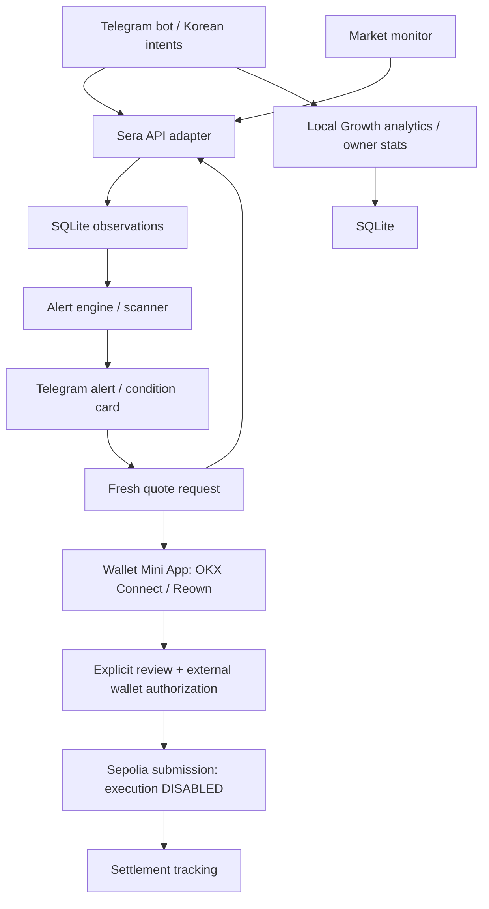

# FX Alert Bot
A Korean-first Telegram FX monitoring, alert and testnet trading interface powered by Sera Protocol.

환율과 거래 가능 규모를 확인하고, 원하는 조건에 도달하면 Telegram으로 알려드려요. 한국어가 기본이며 영어도 지원합니다. Product: [@world_fx_alert_bot](https://t.me/world_fx_alert_bot).

**Market monitoring → notable FX condition → Telegram alert → fresh quote → explicit confirmation → Sera trade flow.**

FX Alert Bot helps users:

- Monitor stablecoin FX pairs.
- Check notable market conditions and why they appeared.
- Create personal exchange-rate and market-condition alerts.
- Check quoted trade sizes and retrieve fresh quotes.
- Move from an alert into a testnet trade flow that requires explicit review and wallet approval when execution is separately enabled.

**Powered by Sera Protocol.**

**Current release: Phase 6, local Growth analytics.** Korean-first, with English commands and UI. This is not auto-trading: an alert never authorizes a transaction. Mainnet is rejected, even when explicitly configured. The external-wallet Sepolia execution architecture exists, but **execution remains OFF** pending live acceptance. No real Sepolia swap or complete settlement has been verified. This is an experimental MVP, not an audited trading release. Start with [Install](#install).

The branding and Korean UX pass changes presentation only. See [BRANDING.md](BRANDING.md) for attribution policy, terminology, command audit and the deliberately unchanged ownership-signature wording. Local deterministic Korean parsing and local Phase 6 Growth analytics are available. Execution and mainnet stay OFF.

## Features and verification status

Labels describe evidence, not guarantees. **LIVE TESTED** means the specific check below; **AUTOMATED TESTED** means local tests with mocked APIs where appropriate. Phone UX checks are separate in [ACCEPTANCE.md](ACCEPTANCE.md).

| Implemented feature | Status and limits |
|---|---|
| `/markets`, `/rate`, `/quote`, `/liquidity` | **LIVE TESTED** Sera read-only probes; **AUTOMATED TESTED** Telegram flows. Liquidity means valid quotes for probed sizes, not verified total order-book depth. |
| `/alpha` scanner | **LIVE TESTED** Sera sample collection/local result rendering; **AUTOMATED TESTED** signals and callbacks. Covers configured probes; no profit or arbitrage claim. |
| Personalized alerts, `/alerts`, `/deletealert` | **LIVE TESTED** Sera observations/fresh quote probes; **AUTOMATED TESTED** crossings, cooldowns, persistence and delivery. Actual phone push acceptance remains **NOT YET LIVE VERIFIED**. |
| Fresh quote callbacks | **LIVE TESTED** new Sera quote retrieval; **AUTOMATED TESTED** user-owned button flows. Never trades automatically. |
| Korean natural-language requests | **LIVE TESTED** read-only Sera/controller probes; **AUTOMATED TESTED** deterministic parser and Telegram routing. Latest phone UX **NOT YET LIVE VERIFIED**; English NLU is not implemented. |
| Telegram Mini App, OKX Wallet, ownership verification | **LIVE TESTED** owner-reported Telegram mobile OKX connection/proof; backend live preflight. Latest two-visit ownership handoff still **NOT YET LIVE VERIFIED**. |
| MetaMask / Reown connection path | **AUTOMATED TESTED** adapter/UI/routing; **NOT YET LIVE VERIFIED** on a real phone. |
| Growth analytics, source tracking, owner-only `/stats` | **AUTOMATED TESTED** aggregates, authorization, exclusions and funnels; **LIVE TESTED** read-only local database rendering. Phone `/stats` acceptance **NOT YET LIVE VERIFIED**. |
| Explicitly reviewed Sepolia swap/settlement architecture | **AUTOMATED TESTED** safety/state machine; **NOT YET LIVE VERIFIED** submission and full settlement; execution **DISABLED**. |
| Mainnet / auto-trading | **DISABLED**. Mainnet is rejected; no unattended signer exists. |

See [STATUS.md](STATUS.md) for dated evidence and [GROWTH_ANALYTICS.md](GROWTH_ANALYTICS.md) for metric definitions. A submission attempt or pending transaction never counts as a completed trade.

## Start Live Testing

Configure your own credentials using [Install](#install). Existing operators should preserve their private `.env` and database. Real OKX Web3 connection and ownership verification were reported by the original operator on Telegram mobile; this does not establish your deployment's readiness. Two separate wallet visits remain, and the latest one-button handoff needs a real-device check. See [OKX_CONNECT.md](OKX_CONNECT.md#phase-46--wallet-connection-ux) and [Wallet UX Acceptance](ACCEPTANCE.md#wallet-ux-acceptance).

The one-time account settings belong in this project's local `.env`:

1. `TELEGRAM_BOT_TOKEN`: your own BotFather token, configured once.
2. `EXECUTION_USER_IDS`: your numeric Telegram ID, configured once. This bot's `/wallet` displays it.
3. `WALLETCONNECT_PROJECT_ID`: create your own **dedicated development project** at [Reown Dashboard](https://dashboard.reown.com/) and paste its 32-character Project ID once. Leave that new development project's origin allowlist empty; see the tradeoff below. Do not use a sample/shared ID.
4. In the project PowerShell window, run:

   ~~~powershell
   npm run dev:live
   ~~~

5. Open your bot's private Telegram chat and send `/wallet`. You perform your own wallet connection and ownership approval later.

This command runs tests, typecheck and build, locates/downloads Cloudflare, starts the bot and temporary HTTPS tunnel, applies its origin and checks readiness. **No second terminal or URL copying.** New launches watch source files and the Project ID: stable changes trigger checks/builds and reload the owned bot on the same tunnel. The server serves rebuilt page assets immediately on a fresh `/wallet` opening. Already open authenticated Mini Apps are not forcibly reloaded during wallet approval. Keep the window open; **Ctrl+C stops its bot and tunnel**.

The page works without Reown, but wallet connection stays unavailable. The launcher always forces **Sepolia, execution OFF and mainnet OFF**, even if `.env` requests otherwise. Follow [ACCEPTANCE.md](ACCEPTANCE.md) for later owner checks.

**Development tradeoff:** [Reown documents](https://docs.reown.com/cloud/relay) that an empty allowlist permits all origins. For a separate temporary development project, that avoids re-registering random tunnel addresses. Other sites could use that public project's relay quota. Telegram authentication, exact app Origin/Host, CSRF, ownership proof and financial gates remain enforced. We never clear an existing project's allowlist or spoof localhost. For long-term restricted use, choose a stable domain/tunnel with an exact allowlist. Localhost's exemption does not apply to Telegram's public HTTPS page.

## Natural Language

한국어 요청은 명령어와 같은 구조화된 동작으로 연결됩니다. 지원 코인과 페어는 현재 Sera 목록에서 확인합니다.

- “USDC/XSGD 환율 알려줘” — 현재 참고 환율.
- “100 USDC를 XSGD로 바꾸면 얼마 받아?” — 새로운 조회용 Quote.
- “USDC/XSGD가 1.35 넘으면 알려줘” — 목표 이상 알림 초안. 모니터링 금액을 입력한 뒤 **알림 만들기**로 확인합니다.
- “1.30 이하면 알려줘” — 직전 페어의 목표 이하 알림 초안.
- “6시간 동안 0.5% 이상 움직이면 알려줘” — 직전 페어의 절대 변동폭 알림 초안. 1/6/24시간, 시간/hr/h, %/퍼/퍼센트를 지원합니다.
- “지금 볼만한 FX 조건 있어?” / “내 알림 보여줘” — 기존 /alpha /alerts 화면.
- “USDC 5개 XSGD로 바꾸고 싶어” — 새 Quote만 준비. 지갑 연결과 거래 승인은 기존 버튼/지갑 흐름에서 직접 진행합니다.

Natural language is converted into the same deterministic actions as commands. It never independently connects a wallet, signs, prepares a financial authorization payload or submits a transaction. Execution and mainnet stay OFF. Rate alerts use the existing size-specific, cost-inclusive quoted rate, not the reference rate displayed by /rate. Because a monitoring amount is material to that calculation, the bot asks for it rather than guessing. The normal alert preview explains the interpretation and requires its existing user-owned, expiring confirmation button. No new alert calculation or scanner threshold is introduced.

Implementation: src/nlu/parser.ts extracts a bounded set of intents/entities; src/nlu/context.ts retains only structured pair/pending fields in process memory for **5 minutes**, with a **1,000-entry cap**. Context is isolated per user, revalidated against the current registry, cleared by unrelated commands/buttons, unknown input and cancellation, and lost on restart. A completed pair query can establish a new context. Existing wizard/confirmation lifetimes are unchanged; use /cancel before leaving an active command or alert wizard. No raw conversation text is stored or logged by NLU. Token symbols are case-insensitive; amounts remain exact decimal strings and pass existing precision/minimum checks. Unsupported tokens, unlisted pairs, conflicting directions, invalid numbers and unsupported windows are rejected; uncertain requests get examples or a concise follow-up.

**No LLM, external AI requests, new API key or new dependency.** English commands remain available; English natural-language interpretation is deferred. This is a narrow parser, not a general Korean conversational model. Destination-first phrasing, multiple requests, synonyms outside the documented set and alerts specifying every field in arbitrary word order may need commands or a clearer request.

Quote/alert records carry command, button or natural_language input labels in separate foreign-key metadata tables. These labels do not replace existing quote/alert-trigger provenance or modify financial state. Labels follow the initiating wizard; a quote refresh is a new button action. Metadata cascades with record deletion and /forget. Phase 6 reuses these labels for local aggregate reporting; see [Growth Analytics](#growth-analytics).

See [Korean Natural Language acceptance](ACCEPTANCE.md#korean-natural-language) for phone checks. Automated/local browser checks do not establish real Telegram mobile acceptance.

## Why this exists
Most chat trading tools start when a user requests a trade. This project adds proactive, personalized FX conditions so users can monitor a desired rate or trade size, receive an explanation, then request a new quote. Conditions never authorize a transaction or imply guaranteed profit.

## Research and attribution
Read [RESEARCH.md](RESEARCH.md) for the source, license and API investigation completed before implementation.
Haruki Kondo / mashharuki's [technical article](https://zenn.dev/mashharuki/articles/web3_sera_protocol-8) and community bot architecture informed the design.
The original telegram-bot path was deleted in August and relocated to an unlicensed repository.
Only the decimal-precision helper from the explicitly MIT-licensed July snapshot is adapted; its full copyright/license is preserved in [THIRD_PARTY_NOTICES.md](THIRD_PARTY_NOTICES.md).
The remaining implementation is independent. This project's license is [MIT](LICENSE). Dependency licenses remain applicable.

## Architecture
TypeScript + grammY provide the Telegram interface; SQLite persists users, observations, alerts, outbox, wallet references and local analytics. The Telegram Mini App uses OKX Connect for OKX and Reown/WalletConnect for the MetaMask path.



```text
Telegram private chat -> grammY adapter -> BotController / AlertController
                                             |                 |
                                         MarketService     Store -> SQLite
                                             ^                 ^
Configurable loop -> shared quote observations -> evaluate -> atomic trigger/outbox
                                                              |
                                               Telegram notification sender
                                                              |
                                      latest-quote button -> NEW MarketService.quote
```
- src/bot: Telegram transport, conversational commands, safe text/buttons and quote cards.
- src/sera: runtime schemas, exact amount conversion, allowlisted API client and market service; separate gated swap capability.
- src/alerts: quote observations, exact condition evaluation, monitor, notification formatting and sanitized logs.
- src/scanner: configured public probes, local signal evaluation, deterministic ranking and grouped result cards; uses the existing monitor.
- src/database: versioned SQLite migrations, repository interfaces, conversations, alert state, history and delivery outbox.
- src/i18n: Korean product wording, English, simple FX glossary.
- src/config: validated environment and testnet-first policy.
- src/utils: bounded cache, request queue/pacing and redacted errors.
- tests: mocked Sera/Telegram flows, calculation/precision/error handling and database restart persistence.
- scripts/sera-smoke.ts: live Sepolia read-only catalog/rate/quote probes.
- scripts/alerts-smoke.ts: live grouped alert observation and fresh-button quote check; no Telegram transport.
- scripts/scanner-smoke.ts: live public sample collection, local scanner reads and a fresh result-button quote; no Telegram transport.

The bot, monitor and scanner coverage share one MarketService, Sera client and request queue. /alpha itself reads SQLite only. src/wallet handles identity, ownership, on-chain reads and the companion HTTP server; src/trades validates and orchestrates consent, submission and settlement; web/ is the external-wallet interface. Only the trade orchestrator receives the submission capability. Market, scanner and notification workers cannot sign or submit. There is no server-side signer. Phase 5 maps local Korean intent/entities to these same controllers. src/analytics adds best-effort local events, durable-state projection and aggregate owner reports; it has no signing/submission capability.

Node 24's SQLite implementation is used without an extra native npm driver. Its API is still marked release candidate by Node; keep the runtime on the tested Node 24 line and validate upgrades. WAL/foreign keys/busy timeout are enabled. Async repository boundaries and portable fields leave room for a PostgreSQL adapter; PostgreSQL is not implemented yet.

## Install
Requirements: Node.js **24.x**, npm, Git, a dedicated BotFather bot token. Wallet checks additionally need your own dedicated development Reown Project ID and a Sepolia RPC URL. Compilation and automated tests require **no `.env`, token or wallet**. Windows PowerShell is supported.

```powershell
git clone https://github.com/sunmool25x/fx-alert-bot.git
cd fx-alert-bot
npm install
Copy-Item .env.example .env
```

The GitHub URL is the intended publication target; it is unavailable until the owner publishes. On macOS/Linux, use `cp .env.example .env` instead. Keep the lockfile; subsequent reproducible installs can use `npm ci`.

1. In Telegram, ask **@BotFather** to create your own bot with `/newbot`. Put its token only in local `TELEGRAM_BOT_TOKEN`. Never share it in chat/issues.
2. Keep `SERA_NETWORK=sepolia`, `ENABLE_MAINNET=false`, `ENABLE_TESTNET_EXECUTION=false`. Read-only commands work without a wallet or Reown ID.
3. For wallet testing, set your numeric tester ID in `EXECUTION_USER_IDS` (allowlisting does not enable execution), your own `SEPOLIA_RPC_URL`, and `WALLETCONNECT_PROJECT_ID` from [Reown Dashboard](https://dashboard.reown.com/). Use a separate temporary-development project with the allowlist tradeoff described above, or a stable HTTPS domain with its exact allowlist. Do not use another person's Project ID.
4. `DATABASE_PATH=./data/bot.sqlite` is created and migrated automatically on successful startup. No separate SQL initialization command is required. The process must have write access to that directory. Existing Phase 6 upgrades create a local backup; both the database and backups stay ignored.
5. Validate and launch:

```powershell
npm test
npm run typecheck
npm run build
npm run dev:live
```

`dev:live` runs checks/build, obtains temporary HTTPS and launches exactly one bot, always forcing execution/mainnet OFF. Keep that terminal open. Do not run `npm start` alongside it with the same token. For read-only polling without the wallet/tunnel launcher, use `npm start` after building. Missing credentials fail startup with a sanitized message; they do not prevent compilation. Configure `/stats` admin/exclusion IDs as described in [Growth Analytics](#growth-analytics).

## Telegram runtime
Use the single launcher above and your own BotFather setup.

The MVP uses long polling and one process per token. An existing webhook causes startup to fail; the bot does not remove webhooks or drop pending updates. A webhook deployment requires a separately implemented authenticated endpoint.

Acquisition deep links: https://t.me/world_fx_alert_bot?start=community_a and https://t.me/world_fx_alert_bot?start=telegram_group_a.
First valid touch is immutable; latest touch may update. Sources are lowercase ASCII letters/digits/underscore/hyphen, maximum 48 characters; invalid payloads become unknown and no payload means direct. Existing legacy first source is preserved. This is attribution only, with no referral rewards. See [Growth Analytics](#growth-analytics).

## Recommended BotFather metadata

These are copy recommendations for the owner to apply manually. This pass does not update BotFather or Telegram metadata remotely. The copy is kept conservatively short; no unverified field limit is assumed.

**Username:** `@world_fx_alert_bot`
**Name:** `FX Alert Bot`

**Short description / About — Korean**

> 환율을 확인하고 원하는 FX 조건이 오면 Telegram으로 알려주는 FX 모니터링 봇.

**Short description / About — English**

> Monitor FX markets, set personal rate alerts, and check fresh quotes from Telegram.

**Description — Korean**

> FX 시장을 확인하고 목표 환율·시장 움직임·거래 가능 조건을 알림으로 받아보세요.
>
> 자동 거래 없이, 알림 → 최신 Quote → 직접 확인하는 방식으로 동작합니다.
>
> Powered by Sera Protocol.

**Description — English**

> Explore FX markets and get alerts for target rates, market movements and quoted trade sizes.
>
> Alert → fresh quote → your review. No automatic trading.
>
> Powered by Sera Protocol.

Keep the short text in the compact About/short-description field and the longer text in Description. Command descriptions are defined locally in `src/index.ts`; the existing startup registration behavior is unchanged. A running process needs a normal restart to load the new bot copy; do not run a second polling process for the same token.

## Environment
| Variable | Default | Meaning |
|---|---|---|
| TELEGRAM_BOT_TOKEN | empty | Required for live Telegram; not needed for API smoke or tests |
| SERA_REFERRAL_URL | empty | Optional owner-supplied attribution URL, reserved for documentation/footer use; no runtime referral UI or transaction attribution change |
| SERA_NETWORK | sepolia | Sepolia only; mainnet is rejected |
| ENABLE_MAINNET | false | Must remain false; true is rejected |
| ENABLE_TESTNET_EXECUTION | false | Owner-controlled Sepolia switch; also requires setup and per-user allowlist |
| DATABASE_PATH | ./data/bot.sqlite | SQLite file; automatically initialized |
| SERA_REQUEST_INTERVAL_MS | 500 | Minimum API request-start spacing, at least 250 ms |
| SERA_TIMEOUT_MS | 15000 | Request timeout, bounded to 30 seconds |
| SERA_RETRIES | 2 | GET retries for 429/503; no quote POST retries |
| SERA_MAX_RETRY_WAIT_MS | 2000 | Maximum inline retry wait; longer server delays fail promptly and block subsequent requests until Retry-After |
| SERA_RATE_CACHE_MS | 10000 | Reference FX cache; source timestamp remains visible |
| SERA_REFERENCE_MAX_AGE_SECONDS | 900 | Stale reference warning |
| LIQUIDITY_PROBE_SIZES | 100,1000,10000 | Up to five source-token sizes, not dollar notionals |
| CONVERSATION_TTL_SECONDS | 900 | Wizard and refresh-intent TTL |
| MARKET_POLL_INTERVAL_SECONDS | 60 | Delay after a monitoring cycle finishes; minimum 60, maximum 3600 |
| MARKET_POLL_INTERVAL_MS | unset | Legacy fallback (60000–3600000); explicit seconds setting takes precedence |
| ALERT_COOLDOWN_SECONDS | 3600 | Per-alert minimum time between triggers; minimum 60 |
| ALERT_MAX_GROUPS_PER_CYCLE | 10 | Maximum unique pair/direction/amount probes per cycle; maximum 20 |
| ALERT_MAX_PER_USER | 20 | Maximum saved alerts per user |
| ALERT_MAX_TOTAL | 500 | Maximum saved alerts for this single instance |
| ALERT_BASELINE_TOLERANCE_SECONDS | 300 | Historical sample tolerance, further capped at 10% of the requested window |
| ALERT_OBSERVATION_RETENTION_HOURS | 72 | Shared observation retention; minimum 26 hours to cover the 24h window |
| ALERT_NOTIFICATION_TTL_SECONDS | 900 | Expire undelivered notifications after this age |
| ALPHA_ENABLED | true | Add configured discovery probes to the existing monitor; false disables /alpha and its background jobs |
| ALPHA_PROBES | USDC/XSGD:100,USDC/EURC:100,XIDR/USDT:1000000 | Directed pair:source-token-amount entries; 1–12, no duplicates; symbols/pairs and token precision/minimum are checked against the live registry |
| ALPHA_MAX_RESULTS | 12 | Maximum distinct directed pairs in a feed; 1–12; pages show 3 cards |
| ALPHA_DATA_MAX_AGE_SECONDS | 180 | Maximum age of a displayed observation; 30–900; also maximum gap between samples establishing recovery |
| ALPHA_MOVEMENT_1H_PCT | 0.5 | Absolute 1-hour movement display threshold (%) |
| ALPHA_MOVEMENT_6H_PCT | 1 | Absolute 6-hour movement display threshold (%) |
| ALPHA_MOVEMENT_24H_PCT | 2 | Absolute 24-hour movement display threshold (%) |
| ALPHA_RECOVERY_MAX_AGE_SECONDS | 900 | Recovery visibility window, 60–86400 seconds; current observation must independently be fresh |

Scanner movement thresholds must be positive plain decimals ≤100. The defaults are conservative display filters, not recommended trading thresholds. Probe amounts are token units, not comparable dollar notionals. Change .env and restart to apply settings. No probe is automatically resized when it violates a token minimum.

No Sera API key or private key is needed for these read-only features. Later account functions require wallet-specific authorization; an operator's Sera credentials must never be reused for every Telegram user.

## Database and privacy
On startup the version 1 migration creates users, conversations, quote_intents and schema_migrations. Version 2 adds alerts, market_observations, alert_triggers and delivery_outbox. Version 3 adds scanner_probes: at most 12 configured public probe summaries, with resolved pair/amount, last attempt/error, last observed availability/time and recovery time. Existing records are preserved. Back up an existing database before the first upgraded startup.
Stored information: Telegram operational user ID, language, existing first source, created/last-seen timestamps, expiring token selections, amount/pair settings, alert conditions, evaluation state, cooldown and trigger/delivery history. Scanner summaries contain no user IDs or personal thresholds. They reuse market_observations for history and quote_intents for user-owned result buttons. Migration 6 adds local aggregate analytics and normalized attribution; see [Growth Analytics](#growth-analytics).
No usernames, personal names, phone numbers, location, message history, raw private keys, signatures or Sera API secrets are stored.
Telegram still stores chat messages. /forget requires a fresh confirmation and deletes the user's stored bot records, including conversations, quote intents, alerts, triggers, terminal trade records and pending deliveries. It is blocked while a submitted/unknown trade still needs reconciliation; disconnect remains available. /deletealert also cancels dependent pending deliveries. A send already in flight cannot be recalled. Phase 4 migration details and backup behavior are below.
Market observations are shared and contain no Telegram IDs. The monitor prunes them after 72 hours by default and removes terminal trigger/delivery history after 30 days. Active alerts remain until deleted. Failed/expired delivery status is visible in /alerts. Logs contain random operational record IDs; restrict access and rotate logs at the host.
Expired conversations are removed on access; expired quote intents are removed when new ones are saved. Stored quote-button intentions are not executed and have separate TTLs from live quote expiry.
Restrict data-directory permissions. Use SQLite's online backup tool or stop the process before copying the database; an active WAL database must not be backed up by copying only its main file.

## Sera integration and testnet setup
Official references: [testnet API](https://docs.testnet.sera.cx/api-reference/), [system data](https://docs.testnet.sera.cx/api-reference/endpoints/system/), [swap quotes](https://docs.sera.cx/api-reference/endpoints/swaps/), [agents](https://agents.sera.cx/).
The bot calls https://api.testnet.sera.cx/api/v1 and validates chain_id and EIP-712 domain chainId against Sepolia 11155111.
Protocol contract roles come from live configuration and are checked on-chain. The narrow execution token policy pins the verified Sepolia USDC and XSGD addresses. No arbitrary custom Sera API host or redirect is accepted.
Public read endpoints used: GET /config, /tokens, /markets, /system/time, /health, /fx/rate; POST /swap/quote. Only the gated trade service may POST /swap with user signatures. On-chain reads use the configured Sepolia RPC.
The official MCP's simulate approach uses a burn-address quote probe. This bot uses the same documented approach; it does not invent a REST simulate parameter.
Probe quote route fields are checked against the requested pair, amount and probe address. Raw amounts use BigInt; rate calculations use decimal.js.
Catalog metadata is cached with in-flight deduplication. Quotes are never cached.
A HTTP 200 quote with zero minimum output is shown as unavailable.
Fees are labeled only to the extent provided by Sera. Cost is already incorporated into receive_less output; gas is not subtracted again.
No faucet, ETH or funded wallet is needed for these read-only probes.
The [testnet app](https://testnet.sera.cx/) is the starting point for funded-wallet setup in Phase 4. Verify token addresses from the live registry; use test assets only.

## Commands
| Command | Behavior |
|---|---|
| /start | Initialize Korean user settings and optional first acquisition source |
| /markets [USDC] | Paginated registered markets, optionally filtered by a token |
| /rate [USDC EURC] | Select source/destination tokens; show Sera currency reference, source timestamp and stale warning |
| /quote [100 USDC EURC] | Select tokens/amount; obtain new read-only amount-specific quote |
| /liquidity [USDC XSGD] | Sample configured input-token sizes with quotes |
| /alert | Select registered pair, condition, source-token size, threshold/window if needed, then confirm |
| /alerts | Paginated own alerts, current monitor state, last check/delivery, latest status and delete buttons |
| /deletealert | Open own alerts; select Delete and confirm |
| /alpha | Read notable Sera-derived conditions for configured samples; latest quote, prefilled alert setup, markets and pagination |
| /wallet | Verified address, private Mini App connection, disconnect and recent trade states |
| /balance | Actual on-chain USDC/XSGD wallet balances, including zero; no Vault claim |
| /swap [100 USDC XSGD] | Pair/amount selection and shared quote flow; disabled-mode explanation unless explicitly enabled |
| /language | Korean/English preference |
| /help | Commands, glossary and privacy model |
| /cancel | Clear current wizard |
| /forget | Confirm deletion of stored bot data |
| /stats | Owner-only local Growth summary, source and funnel reports |

Pairs can also use slash syntax: /quote 100 USDC/XSGD.
Rate currently selects supported stablecoins and maps their registry currency to ISO reference FX; arbitrary unregistered fiat inputs are not supported.
All tokens are available through paginated selection. Current catalogs can be large; /markets USDC is more convenient than browsing thousands of entries.
Use plain decimal amounts without commas or exponent notation. Excess token precision is rejected rather than silently rounded.
Click 최신 Quote 확인 / Check latest quote to fetch a new quote. Another user or expired intent cannot use the button.
Financial and future-feature commands respond with phase status; they are not listed as working features.

## Alert logic
Every alert has a direction and a source-token amount. Its rate is **quoted minimum output / input**, shown as `1 BASE = X QUOTE`. This includes quoted costs in `receive_less` mode, so fee/gas changes can move the monitored rate. It is distinct from the currency reference shown by /rate. No external DEX or reference feed is used.

| Type | Korean UI | Condition |
|---|---|---|
| RATE_ABOVE | 목표 환율 이상 | Quoted rate ≥ target |
| RATE_BELOW | 목표 환율 이하 | Quoted rate ≤ target |
| QUOTE_AVAILABLE | 거래 가능 규모 | A valid quote with positive minimum output returns for the chosen amount |
| RATE_MOVEMENT | 환율 변동 | Absolute `(current / baseline - 1) × 100` ≥ threshold, over 1, 6 or 24 hours |
| MARKET_RECOVERY | 거래 가능 조건 회복 | Quote unavailable at the chosen size → valid quote available |
| Spread | Hidden | No verified native bid/ask data; reverse quotes or fee-inclusive rates cannot establish the requested spread |

Size and recovery use the same quote-availability transition, with different explanations. They do not represent total depth, exchange-wide reopening or guaranteed execution for the user's wallet. A documented HTTP 400 `NO_LIQUIDITY` or a valid zero-output response means unavailable. Timeouts, 429/5xx, malformed/stale/mismatched quotes, minimum-size and unsupported-pair errors mean **unknown**, and never trigger or rearm an alert.

Movement history comes only from actual stored observations of the **same direction and amount**. Select the sample nearest `current observation time - requested window`, within ±300 seconds by default (also capped at 10% of the window). No interpolation or invented history. Insufficient history leaves the alert active and waiting. Messages show measured movement, baseline rate and actual baseline timestamp. Polling gaps, downtime or high load can leave no sample within tolerance; the alert waits again. Keep the host clock synchronized.

The first valid sample primes state without notification. A fresh setup preview can serve as that first sample only if it is at most 30 seconds old and still valid when saved. A known false → true crossing creates one trigger; remaining true never repeats. A false sample rearms. Default cooldown is one hour per alert. Crossings inside cooldown are consumed: expiry alone never sends a delayed trigger; another false → true crossing is required. Unknown data preserves the last valid condition. Identical saved conditions per user are idempotent.

## Background monitor and delivery
One non-overlapping loop starts when Telegram polling starts. Default delay is 60 seconds **after** each cycle. It groups personal alerts and configured scanner probes by Sepolia + token addresses + direction + canonical amount, obtains one new quote per group, and shares the observation with every matching consumer. Scanner probes collect even before anyone creates an alert. No active alerts plus a disabled scanner means no market requests. Metadata caches and the existing paced client are shared with interactive commands. Quotes are never cached for reuse by a fresh-quote button.

At most 10 groups are probed per cycle, with a 25-second soft polling budget checked between groups. Oldest-evaluated groups rotate first, including across restarts. Large numbers of distinct sizes increase each alert's effective interval; this is not a real-time feed. API requests retain 500ms default minimum spacing, timeouts, bounded GET retries and shared 429/503 Retry-After handling. Numeric Sera quotas remain unconfirmed; validate capacity with Sera before scaling.

State change, trigger reason/time and outbox insertion commit in one SQLite transaction. A persisted sequence plus unique constraints prevents duplicate triggers. The delivery worker attempts up to 10 messages before and 10 after each poll, spaced by at least 1.1 seconds. It uses a separate Telegram API instance with retries controlled by the outbox: exponential backoff, server Retry-After, up to 8 attempts, 15-minute default TTL, terminal failure for blocked/rejected chats. An expired two-minute delivery lease can be reclaimed after restart. Delivery continues even during Sera outages.

Delivery is bounded and recoverable, **not exactly once**: Telegram has no send-message idempotency key. If Telegram accepts a message but the acknowledgement or database write is lost, a retry may duplicate it. Failed or expired messages are not retried forever. Deletion cancels queued messages; it cannot retract an already accepted or in-flight send.

The notification's **최신 Quote 확인** button loads only the user-owned pair/amount and calls the existing uncached `MarketService.quote` again. It does not reuse the trigger observation, quote UUID or route. The response shows minimum output/rate, provided gas cost, expiry and probe limitations. With wallet setup configured, **테스트 거래 계속** opens the separate wallet flow. This button is navigation, never financial consent.

## Testing Alerts Locally
1. Open PowerShell and run `cd fx-alert-bot`. Install Node 24 first if necessary. Run `npm ci`. Keep your existing `.env`; if absent, run `Copy-Item .env.example .env`. Edit only this project's `.env` and put your own BotFather token in `TELEGRAM_BOT_TOKEN`. Keep `SERA_NETWORK=sepolia`, `ENABLE_MAINNET=false` and `ENABLE_TESTNET_EXECUTION=false`.
2. Keep `MARKET_POLL_INTERVAL_SECONDS=60`. For a shorter testing cooldown you may set `ALERT_COOLDOWN_SECONDS=60` (normal default: 3600). Run `npm run build`, then `npm start`, and leave that terminal open. If HTTPS fails on this Windows machine, run `$env:NODE_OPTIONS='--use-system-ca'` before startup; never disable certificate verification. Existing databases upgrade automatically; no SQL commands are needed.
3. Open your bot in a **private** Telegram chat. Send `/start`, then `/alert`. Select **USDC → XSGD**, **목표 환율 이상**, then enter **100**. This pair had quotes during testing; current testnet liquidity may differ. The bot shows the current amount-specific rate before asking for the target.
4. Choose a target slightly **above** that live rate so the condition starts unmet. For example, if the screen shows `1 USDC = 1.2500 XSGD`, try `1.2501` or about 0.01% higher. These are illustrative numbers, not live prices. For **목표 환율 이하**, choose a slightly lower target. Check the final pair, amount, direction and target; press **알림 만들기**. If the preview is already beyond your target, cancel and choose a new target. An already-met condition will not send an immediate notification.
5. Send `/alerts`. Check the saved condition, last check time and state. **최신 상태** checks the current quote without changing trigger state. Keep the bot running. A push requires a real observed crossing; prices may not cross during the test, and polling can miss brief movements. Creating an already-satisfied alert is not a shortcut to a trigger.
6. When **🔔 설정한 FX 조건에 도달했어요** arrives, check the reason and `1 BASE = X QUOTE` direction. Press **최신 Quote 확인**, then press it again. Each press makes a new Sera request; the new fetch time/expiry should update even if the rate stays identical. The response includes **알림이 발생한 이후 시장 상황이 변했을 수 있어 최신 Quote를 다시 조회했습니다.** No signature prompt or trade execution should appear. Before a crossing, the same retrieval can be checked through `/alerts` → **최신 상태** → **최신 Quote 확인**.
7. Send `/deletealert` (or `/alerts`), press the desired alert's **삭제**, and confirm. Run `/alerts` again. The deleted alert is gone and old alert-specific buttons no longer work. Existing independent Phase 1 quote-refresh intents expire normally.
8. Use `/language` → **English** and repeat setup/list/delete to check English. Stop with Ctrl+C and restart with `npm start`; language and active alerts persist. Movement alerts need actual 1/6/24-hour history before evaluation. Size/recovery alerts need an observed no-quote → valid-quote transition.
9. Inspect the startup terminal for JSON events: `monitor_cycle`, `alert_triggered` (reason and timestamp), `alert_delivered`, `alert_delivery_failed`, `market_observation_failed`. For a saved local log, use `npm start 2>&1 | Tee-Object -FilePath bot.log`. Docker users can run `docker compose logs -f`. Logs do not include private keys, token URLs, message text or raw API responses.

For deterministic crossing/error/restart testing without waiting for a market move, run `npm test`; it mocks both external services. For real Sera reads without a Telegram token run `npm run alerts:smoke` (on this Windows machine: `node --use-system-ca --import tsx scripts/alerts-smoke.ts`). The smoke script uses synthetic users in an in-memory database and cannot send Telegram messages. Neither is a claim of live Telegram acceptance.

## What /alpha shows
Send /alpha to see **지금 확인해볼 FX 조건**: a short list of Sera-derived conditions worth checking. It covers the configured sample set, not all thousands of registered markets. Each card gives the direction, source-token amount, last observed rate, timestamp and why it appeared. It is not a buy/sell recommendation, profit forecast, arbitrage detector or comparison with other venues.

Signals:

- **Movement:** a 1h/6h/24h change whose absolute magnitude reaches the configured threshold. Calculation: (current quoted rate / historical quoted rate − 1) × 100. Positive and negative signs show direction, without calling either good or bad. Rates use quoted minimum output / input at the same amount, including quoted costs. Fee changes can contribute to movement.
- **거래 가능 규모 / quote availability:** the latest check returned a valid positive-output Sera quote at the stated source-token amount. It is neither total liquidity nor order-book depth, and a probe address does not guarantee your wallet can execute.
- **Quote recovery:** two actual monitor observations establish unavailable → available, no more than ALPHA_DATA_MAX_AGE_SECONDS apart. First observation, unknown/error data and gaps longer than that cannot establish recovery. Remaining available never resets the recovery timestamp. Recovery stops appearing after 15 minutes by default, or on observed unavailability.

Spread remains unavailable because verified bid/ask data is missing. Personal target rates remain in /alert; the scanner does not inspect or expose other users' thresholds or counts near them. There is no AI ranking. Growth reports are local and owner-only.

## Scanner freshness, ranking and API load
Current observations must be less than 180 seconds old by default and cannot have future timestamps. A failed latest probe suppresses that sample until a successful observation arrives, even if an older success is still recent. Warming, stale, no-quote, error, partial-data and insufficient-history states are explicit. Old data is excluded; /alpha does not launch a mass refresh.

Observation freshness is different from the original quote's roughly 30-second expiry. The scanner describes a **past check**, with its timestamp. Its saved observation/quote is never presented as usable for execution. Press **최신 Quote 확인** to request current data.

Movement uses the nearest actual same-direction/same-size observation to current observation time minus the window. Tolerance reuses ALERT_BASELINE_TOLERANCE_SECONDS (default ±300 seconds, capped at 10% of the window). Baseline times are displayed. Missing history means no movement signal; quote availability can still appear. History is shared with Phase 2 and retained by its existing 72-hour policy.

Internal **notability** is only display ordering and is not shown as a trading score. Let F = 1 − observation_age / ALPHA_DATA_MAX_AGE_SECONDS, for a fresh observation:

- Movement: 20 × min(5, abs(movement_pct) / configured_threshold) × F.
- Recovery: 60 × (1 − recovery_age / ALPHA_RECOVERY_MAX_AGE_SECONDS) × F, only inside the recovery window.
- Quote availability: 5 × F. Raw token amounts are not comparable between currencies and add no ranking weight.

Scores round to 8 decimal places. A card takes the maximum signal score, rather than summing correlated signals. Signal ties use signal-type alphabetical order then shorter window. Card ties use newest observation then lexical network/address/amount key. One card consolidates all qualifying windows at one explicit amount. If several amounts qualify for the same directed pair, only its highest-ranked card is shown; historical rates are never mixed across sizes. Reverse directions remain separate. Apply ALPHA_MAX_RESULTS after consolidation. Three cards are sent in one Telegram message per page; each page recomputes freshness/ranking, so positions can change.

The existing monitor merges public probe jobs with alert jobs under the **same** per-cycle group limit, soft time budget, request queue and oldest-evaluated rotation. Default scanner-only activity adds at most **3 quote POSTs per cycle**, plus cached catalog/configuration and server-time reads. An identical user alert costs no additional quote. Repeated /alpha calls and page changes make **zero Sera requests**; they read local data and save expiring button contexts. Current supported pairs are verified through existing /tokens and /markets methods. No endpoint or market field was added to the Sera adapter.

Configured probe summaries survive restart, contain no user identity and are removed when a probe is removed from configuration. Changing resolved token addresses resets that probe's prior availability. Large alert workloads can delay scanner samples beyond freshness limits; reduce probes or tune the shared budget only within provider limits. Public numeric quotas remain unconfirmed.

## Discovery to personal alerts and fresh quotes
**최신 Quote 확인** loads a user-owned, expiring pair/amount intent and calls the existing uncached quote service. It shows current output/rate/costs/expiry and **시장 상황이 변했을 수 있어 최신 Quote를 다시 조회했습니다.** It performs no signing, transaction preparation or submission.

**알림 설정** reuses the Phase 2 wizard with pair and amount already selected. The primary signal suggests movement, quote recovery or size availability. For movement, the user enters their own threshold and chooses 1/6/24 hours. For size/recovery, the existing confirmation screen appears. **No alert is created until 알림 만들기 is pressed.** Normal /alert remains available for different conditions or amounts. **시장 보기** reuses the existing market list filtered by the source token.

## Testing `/alpha` Locally

1. Open the project in PowerShell: `cd fx-alert-bot`. Keep the existing .env and database. Set your dedicated BotFather token locally if it is not configured. Do not paste it into chat.
2. Keep SERA_NETWORK=sepolia, ENABLE_MAINNET=false and ENABLE_TESTNET_EXECUTION=false. The defaults in .env.example enable ALPHA_ENABLED=true and the three sample pairs. Existing .env files inherit these defaults without being overwritten.
3. Run npm ci, npm run build, then npm start. On this Windows machine, set $env:NODE_OPTIONS='--use-system-ca' first if HTTPS certificate verification fails. Leave the terminal running.
4. In your bot's private Telegram chat, send /start, then /alpha. If it is still collecting data, wait about 60–90 seconds and try again. Two of the default samples had quotes in the live check; future testnet availability may differ. An empty or partial result is valid behavior.
5. Check each card's direction, amount, reason and last-check timestamp. Fresh quote-availability cards need no long history. Leave the process running for 1/6/24 hours to build movement history. Do not expect movement or recovery to appear unless real observations meet the criteria.
6. Press a numbered **최신 Quote 확인** button twice. Check the new retrieval time and expiry; the rate may stay the same. You should see the market-change sentence, with no trade/signature button.
7. Return to /alpha and press **알림 설정**. For movement, enter your own percentage and choose a window. Review the pair, amount and condition, then press **알림 만들기**. Verify it with /alerts. Before confirmation, no subscription should exist. Manage or delete it through the existing commands.
8. Press **시장 보기** to open the existing markets list. If more than three distinct pairs qualify, use 이전/다음; the feed intentionally sends one message per page. Switch /language to English and repeat.
9. For a restart check, stop with Ctrl+C and start again. Existing alerts, language and scanner summaries persist; old scanner samples expire normally. After downtime, history gaps are not fabricated into a recovery.
10. Watch terminal JSON logs: monitor_cycle, scanner_catalog_failed, scanner_probe_invalid and market_observation_failed. Use npm start 2>&1 | Tee-Object -FilePath bot.log to keep a local log. /alpha reads should not generate new monitor cycles or quote probes.

For deterministic threshold/ranking/error tests without waiting on real prices, run npm test. For a small real Sera check without Telegram credentials, run npm run scanner:smoke (on this Windows machine: node --use-system-ca --import tsx scripts/scanner-smoke.ts). It uses an in-memory database, never fabricates history and sends no Telegram messages. Mocked tests and this read-only smoke do **not** constitute live Telegram acceptance.

## Next phase gates
Phase 4 adds external-wallet ownership, exact trade review and gated Sepolia submission. Owner-reported OKX connection is working; latest UX/NLU/Growth phone checks and verified trade acceptance remain separate. Korean deterministic NLU and local owner-only Growth/source reporting are implemented. Execution/mainnet stay OFF. This work stops after Phase 6, before recruitment or Phase 7.

## Safety model
Market-facing interfaces have no submission method. The trade service alone receives the gated /swap capability; the server has no signer. Execution is disabled by default and mainnet configuration is rejected.
Trade requests and AI will never authorize spending. There is no server private-key signing, export/import command, hidden transaction or automatic trade.
Buttons are user-scoped, expired conversation stages are rejected and per-user requests are serialized.
Telegram callbacks are acknowledged promptly. Telegram 429 retries are bounded. API 429/503 Retry-After applies to the shared process queue; public numeric rate limits still need confirmation before scaling.
Logs contain event codes, timestamps, random operational alert/trigger/delivery IDs and counts, without Telegram IDs/text, API bodies, tokenized URLs or exception stacks.
The product does not present market movement as arbitrage, guaranteed profit or investment advice.

## Deploy
Use one persistent Node 24 process on a VPS/container with a persistent writable data volume and platform-managed secret injection.
Run npm ci, npm run build, npm start under a process supervisor with graceful SIGTERM. Keep outbound HTTPS access to Telegram and Sera available.
A [Dockerfile](Dockerfile) and [compose.yaml](compose.yaml) provide a single polling-instance recipe. Set your token in .env then:
```bash
docker compose up --build -d
docker compose logs -f
```
The named volume preserves SQLite and the container runs as the node user. Docker recipes require local deployment validation; do not claim they are deployed.
Do not use ephemeral serverless storage for SQLite or run multiple replicas against this polling token. PostgreSQL/shared worker leases and budget coordination come before horizontal scaling.
No cloud resources, public endpoint, Telegram webhook or production deployment is created by this repository.

## Verification
```bash
npm run typecheck
npm test
npm run build
npm run sera:smoke
npm run scanner:smoke
```
Unit/integration checks mock external APIs and cover parsing, exact arithmetic, minimum sizes, zero output, quote binding/refresh, Retry-After, caching, Korean commands, grammY transport and persisted database state.
Phase 2 tests cover above/below thresholds, movement baselines, no-liquidity vs errors, cooldown/rearm, grouping, outbox retry/lease recovery, migrations, restart persistence, pagination, Korean/English setup, user isolation and a new HTTP quote request per alert-button tap.
Phase 3 tests cover each movement window/direction, threshold and history boundaries, recovery/expiry/errors, freshness, deterministic capped ranking, consolidation, privacy, shared request budgets, pagination, Korean/English states, new HTTP quotes and explicit alert-prefill confirmation. The original Phase 1 test for /alpha now expects its implemented response rather than a future-phase placeholder; all previous test cases remain.
Live smoke validates network, catalogs, reference data and a few quote probes. It never signs or submits financial mutations and does not require a Telegram token.

Live acceptance follows [ACCEPTANCE.md](ACCEPTANCE.md) after the setup guide below. Automated checks/public probes do not establish live wallet or transaction acceptance.

## Known limitations
Phase 4 is not a production-ready or security-audited release. Live Telegram, external-wallet, mobile return behavior and confirmed testnet transaction acceptance remain pending.
Testnet liquidity and prices change. Research found positive USDC/XSGD and XIDR/USDT probes, and no USDC/EURC liquidity at the sampled size; never hardcode those outcomes.
Quotes are short-lived (~30 seconds) and sampled liquidity is independent, gas-inclusive and not total order-book depth.
Reference FX is distinct from executable token FX. Stale data is visibly labeled; historical fields may be missing.
One process and local SQLite only. No Telegram webhook server, PostgreSQL adapter, general AI chatbot or web analytics dashboard. The HTTP companion serves wallet sessions only; owner Growth reports use Telegram. Alert observations/outbox and scanner summaries are persistent; their retention is maintained by the shared monitor. The scanner covers a configured sample set, not all Sera markets. No native spread or total-depth signal is claimed. Offline time, budgets and delivery backlogs can delay or miss conditions.

## Phase 4.5 — Live Acceptance Setup

Use [Start Live Testing](#start-live-testing). These details are for troubleshooting and later owner acceptance; the multi-terminal setup is no longer needed.

### Launcher behavior

`dev:live` preserves `.env`. It runs the test/typecheck/build gates, finds cloudflared on PATH/in Downloads, or downloads the official Windows executable into ignored `.dev-live/bin` and verifies GitHub's SHA-256 release digest. Optional `CLOUDFLARED_PATH` selects an existing executable; normally leave it unset.

A 503 bootstrap listener reserves the local signing port while Cloudflare obtains a URL. The launcher then replaces it with the real app using that URL. Telegram starts only with the real origin. The app listens on 127.0.0.1:8787, or configured SIGNING_PORT. No bootstrap page authenticates or performs wallet actions.

The origin, launcher PID and port are stored in ignored `.dev-live/session.json`, with no credentials. The old temporary SIGNING_ORIGIN in `.env` remains untouched but is overridden at runtime. `wallet:preflight` automatically uses the active launcher. Normal shutdown removes its state/lock; dead-process state is ignored/recovered. Temporary URLs are never committed.

Cloudflare receives only a minimal system/network environment, not bot credentials. Its separate generated config leaves the user's `~/.cloudflared` files untouched. Protocol selection is **auto**: forced HTTP/2 failed on this connection; automatic selection registered the edge and passed public HTTPS. Debug/header logging and self-updates are disabled. [Quick Tunnel documentation](https://developers.cloudflare.com/cloudflare-one/networks/connectors/cloudflare-tunnel/do-more-with-tunnels/trycloudflare/).

Only spawned children are managed. Interactive Ctrl+C drains the bot through private process IPC and closes the tunnel. Unrelated processes are never killed by name. The HTTP server has no shutdown or authentication-bypass endpoint. A second launcher is blocked by a repository-local lock.

### Telegram and wallet connectors

The bot uses a private-chat inline `web_app` button: no `/newapp`, Main Mini App registration or Login Widget `/setdomain` is required. Use `/wallet`. If this bot already has a menu pointing at an old Quick Tunnel, its temporary URL is updated automatically. Unrelated/stable menu URLs are preserved and any mismatch is diagnosed. [Telegram documentation](https://core.telegram.org/bots/webapps#inline-button-mini-apps).

The selected WalletConnect Ethereum Provider requires an owner-issued Reown Project ID. The backend supplies it to the authenticated signing page at runtime; launcher/preflight logs never print it. Missing/malformed values leave connection disabled while the read-only app works. No fake ID is sent to the real relay. Format validation is not relay authorization; pairing remains an owner test.

A new, dedicated development project's documented empty origin allowlist avoids repeated domain registration. If you require an origin-restricted project, a stable named tunnel/custom domain is the alternative, with additional owner domain/account setup. The launcher does not create accounts, accept terms, modify Reown settings or connect wallets.

**OKX Wallet uses official OKX Connect** (`@okxconnect/universal-provider@1.9.1`); **MetaMask keeps Reown/WalletConnect**. The OKX SDK generates its Web3 connection URL, passed unchanged to the mobile opening button or one desktop QR. The generic OKX download/exchange URL is rejected. No second wallet chooser or exchange login is used. The existing backend setup gates, including configured Reown readiness, remain unchanged.

Use a current OKX Wallet/OKX App supporting OKX Connect. The selected [official EVM SDK guide](https://web3.okx.com/cs/onchainos/dev-docs/wallet/dapp-connect/app-connect-evm-sdk) documents **OKX App 6.88.0 or later**. The UI shows this requirement without claiming to detect your installed version. The optional OKX UI package is not installed.

On mobile, **지갑 연결** opens a wallet-selection bottom sheet. Select OKX Wallet, then tap **OKX Wallet에서 계속** on its dedicated connection screen after preparation. This deliberate second gesture preserves reliable app opening after asynchronous relay setup. It should open Web3 Wallet approval directly; Exchange home without a connection prompt is a failure. Desktop uses a centered dialog with one SDK-link QR for the OKX **Web3 scanner**. Both paths then explain ownership verification before the separate **지갑에서 확인 / Verify in wallet** action. Success is explicit; closing it preserves the connection. The EVM connector uses `tg://resolve` for mobile connection and signing return, and no Telegram redirect for desktop scanning. Return to the original Mini App; a destroyed/expired view requires a fresh `/wallet` button and ownership proof. No Telegram authentication credentials are added to app links.

Each OKX attempt runs in a disposable frame with memory-only SDK storage and a private message channel. The build includes its script, icon, CSP and dependency notices automatically through `npm run dev:live`. SDK diagnostics containing connection links are stripped and telemetry destinations blocked. Details and remaining live uncertainty: [OKX_CONNECT.md](OKX_CONNECT.md). No financial authorization or execution gate is bypassed.

### Readiness and developer troubleshooting

The owner command shows one compact checklist. A missing Reown ID is an owner gate, not a broken signing server. Detailed diagnostics remain available with `npm run wallet:preflight`, using the system CA store automatically. Execution-OFF WARN is expected; `--offline` does not satisfy live acceptance.

Developer-only `npm run dev:live -- --check` runs startup/probes and then closes its children. It returns nonzero for missing prerequisites. Normal `dev:live` stays open and reloads after a saved Project ID. Do not run another polling instance for the same bot token.

| Result | Action |
|---|---|
| REOWN_PROJECT — HUMAN ACTION REQUIRED | Owner creates a dedicated development project and saves its Project ID once |
| HTTPS_ORIGIN / HTTPS_READ / WEB_BUILD / DATABASE — AUTO-FIXABLE | The launcher starts/builds/checks these; report the code if its bounded checks still fail |
| TUNNEL_NETWORK / TUNNEL_TLS / TUNNEL_CONNECT | Safe connection diagnostics; do not disable TLS. Service/network failures can still block a tunnel |
| CLOUDFLARED_DOWNLOAD | Retry with official GitHub downloads reachable; unverified binaries are not executed |
| LIVE_RUNNING / PORT_BUSY | Use the existing launcher; a developer identifies any older manual process |
| TESTS_FAILED / TYPECHECK_FAILED / BUILD_FAILED | Developer repairs the failing check before live startup |
| TG_READ / RPC_READ / SERA_READ | Check the dedicated bot/provider/service without sharing credentials |

When no launcher is running, preflight checks saved configuration; an expired manual origin may fail. `dev:live` obtains a fresh runtime origin automatically. A fresh developer checkout needs Node 24 and `npm install` once.

Keep the configured Sepolia RPC. The verified public option is `https://ethereum-sepolia-rpc.publicnode.com`; no provider account is necessary to begin. Sera is selected internally at `https://api.testnet.sera.cx/api/v1`. No Sera operator API key, server signer or static session/encryption secret is needed.

### H. Test Telegram, Mini App and wallet without financial authorization

Follow ACCEPTANCE.md sections B–D: /start, /markets, /rate, /quote, /liquidity, /alpha, alert create/delete, /wallet, /balance and disabled /swap.

The Mini App must show **조회 모드 · 거래 실행 꺼짐 / Read-only · Trading is off** (Korean by default) and the Telegram connection acknowledgement. Expand **연결 정보 / Connection details** to compare your own authenticated Telegram ID. The backend verified that identity. Disabled /swap offers quote preparation; its read-only preview has no financial confirmation/sign/submit buttons.

Use a dedicated plain **EOA test wallet** in OKX Wallet or MetaMask. Choose Sepolia. Smart/delegated-code wallets are rejected. Press Connect Wallet and explicitly choose the wallet. Native Telegram mobile offers a selected-wallet continuation button; desktop offers a QR to scan inside that wallet. Approve only connection, return to the original Mini App, read the ownership explanation, then press **지갑에서 확인 / Verify in wallet**. If needed, use the selected-wallet button again to review the ownership request. No Permit/Intent appears during connection. Cancel/choose another wallet creates a fresh isolated attempt. On a wrong chain, select Sepolia in the wallet or use the existing switch action under connection details before ownership. No Telegram authentication credentials are carried in wallet/Telegram links. The Mini App supports Telegram light/dark themes and shows the full verified address on demand; balance reads do not replace the wallet card.

Compare /wallet to your exact wallet address, then check /balance. These are actual wallet USDC/XSGD balances, including zero; no Vault balance is fabricated. Disconnect invalidates local unsubmitted authorizations, but cannot revoke allowances/signed permits or undo submitted swaps. A new Mini App session needs ownership verification again. Reloaded Telegram initialization may show AUTH_REPLAY; close and reopen with a fresh private-chat bot button.

Intended environments are current **Telegram Desktop and Telegram Android/iOS native clients**; neither has yet passed this bot's live acceptance. Telegram Web's cross-site iframe/cookie behavior is not a supported acceptance claim; use a native client. A raw external-browser link is deliberately unauthenticated. WALLET_RETURNED only means the page became visible while a wallet request was pending; it does not prove a signature succeeded.

### I. Obtain the exact supported test tokens

The official [Sera quickstart](https://docs.testnet.sera.cx/quickstart/) links this [verified Sepolia faucet contract](https://sepolia.etherscan.io/address/0x4FAc3BB8B77547E2Da7ed903baDBeD2f46cBe65a#code), **IssueTestTokenV3**. Its public claim() function sends test assets to the calling wallet once per claim epoch. It is not admin-only. The official site also links [app.testnet.sera.cx](https://app.testnet.sera.cx/), whose wallet page requires sign-in for token claims; that signed-in path was not tested.

**LIVE READ-ONLY CHECKED on 2026-09-17 KST:** the faucet list contains our exact USDC/XSGD and sufficient stock for its configured claim. A public-address eth_call simulation of claim() succeeded without changing chain state. This was not a token claim or a check of your eligibility. The current six-decimal-token allocation was 1,000,000,000 mock units each; the bot's 100-test-USDC maximum remains unchanged. Faucet stocks/allocations can change.

To claim yourself:

1. Use the same plain Sepolia test EOA. A **funding claim is a separate wallet-approved transaction** needing some native Sepolia ETH for gas. The bot's later relayed receive_less swap does not ask you to broadcast an ETH-funded swap.
2. If needed, obtain free Sepolia ETH through the faucet linked by Sera's quickstart. Provider eligibility can differ. **Do not buy assets to pass a faucet gate.** If you cannot obtain gas or claim, stop and ask official Sera support through their site for test-funding assistance using your public address only.
3. At the exact Etherscan address above, inspect **Contract → Read Contract**: getTokens, claimAmount and hasClaimed with your address. A true hasClaimed means another ordinary claim cannot be made in the current epoch.
4. If eligible and funded for gas, choose **Contract → Write Contract → Connect to Web3** with that test EOA. Review and invoke **claim with no arguments** yourself. Do not select admin/reset functions or a different recipient. Confirm this funding transaction only in your wallet.
5. After its receipt, use our /balance. Verify USDC at **0x965d4b4546716e416e950bc30467d128455d2d0e** and XSGD at **0x058e06ca2628165a6cd1e80e4dc82203dc0020aa**. Same-symbol tokens at other addresses cannot fund this flow; generic Circle test USDC is not assumed interchangeable.

Insufficient faucet inventory can leave a pending claim. Check balances and seek Sera assistance instead of repeatedly claiming. No funding transaction was performed by the agent. To recheck stock without claiming:

~~~powershell
npm run funding:smoke
~~~

The single pair remains **USDC → XSGD**. A **5 USDC** probe returned a positive validated quote; a 1 USDC probe failed. Five is the smallest successful amount tested here, not a permanent protocol minimum or liquidity guarantee. Start the manual preview at 5. If unavailable, stop and report the code; the application will not resize it.

### J. Complete the read-only execution gate

With execution false, use /quote 5 USDC XSGD and continue into the Mini App. Connect/verify first, then press **내 지갑의 최신 Quote 확인**. This fetches a NEW wallet-specific quote with the same verified recipient and the same contract, balance, permit-metadata and amount checks. It returns display terms only, **no signable trade/version**.

Check input, minimum received (not an invented expected output), rate direction, addresses, costs, expiry and the two future Permit/Intent approvals. Wait for expiry, then request a new preview. Quote life is about 30 seconds with a five-second safety cutoff; it is never extended.

**Stop until YOU have verified all prerequisites:** tests, typecheck, build, full live preflight, real Telegram, authenticated Mini App, wallet connection/ownership, Sepolia, exact supported funds, correct /balance, a successful fresh wallet-specific preview and only your ID allowlisted. Record them in ACCEPTANCE.md. Any failed/unchecked prerequisite keeps execution OFF. Automated tests do not fill live boxes.

### K. Authorize one small test swap yourself, then disable execution

This setup task stops before wallet approval. **dev:live cannot enable trading.** Only after the full owner gate passes in a later session may the owner explicitly authorize the existing execution workflow through the ordinary runtime (`npm start`), with a stable HTTPS origin and all safety gates satisfied. Keep execution false for the current task.

Use /swap 5 USDC XSGD or an existing quote/alert/alpha continuation. Obtain a NEW wallet quote; the read-only preview cannot be promoted. Review its current exact terms and confirm. Explicitly approve the exact token-use Permit, then the Sera Intent, then submit **once**. Both financial requests are explained before they start and remain separate from ownership. Cancellation/expiry requires fresh review and signatures.

Expect SUBMITTING, PENDING, CONFIRMED, FAILED or UNKNOWN. Telegram and Mini App **상태 새로 확인** invoke the same owner-scoped read-only reconciliation, respecting polling/backoff; they cannot submit. Only the matching SOR Intent event and finalized canonical successful receipt with valid token amounts produce completion, verified amounts, IDs, actual hash and explorer button. Finalization can take many minutes. Missing evidence remains unresolved, possibly indefinitely, without an automatic retry or timed release.

After this single test, set execution false again and restart. Keep RPC configured to reconcile submissions. Disconnect cannot cancel submitted transactions. Do not delete an UNKNOWN row or reorg quarantine to force another attempt; report it for investigation. Stop the tunnel when you no longer need the Mini App.

### L. Report failures safely

**If a test fails, send the error code and the terminal log line to the developer.** Include checklist item, Telegram Desktop/Android/iOS version, wallet name and approximate time. Never include initData, cookies, request bodies, signatures, seed phrases, tokens or RPC connection strings. UI/provider errors omit raw stacks.

| Code/check | Recovery |
|---|---|
| TG_CONFIG / TG_READ | Check the local token, polling/webhook compatibility and optional menu URL |
| HTTPS_READ | Run dev:live to manage the bot/tunnel and refresh the runtime origin |
| AUTH_INVALID / AUTH_STALE / AUTH_REPLAY | Reopen from a fresh private-chat bot button; check clock/HTTPS |
| WALLET_CONNECT_CANCELLED | Retry with a fresh wallet selection; for OKX check supported app version/Web3 prompt, for MetaMask check Reown project/origin access |
| OWNERSHIP_REJECTED | Press Connect again for a new ownership challenge |
| NETWORK_MISMATCH | Explicitly switch to Sepolia and reconnect/verify |
| EOA_REQUIRED | Use a plain EOA; smart/delegated wallets are unsupported |
| RPC_UNAVAILABLE / RPC_READ | Check Sepolia RPC and retry reads later |
| INSUFFICIENT_BALANCE | Check exact token address and official funding; do not buy assets |
| NO_LIQUIDITY / UNAVAILABLE | Stop and report; no silent pair/amount changes |
| QUOTE_STALE | Fetch/review new terms, confirm again and obtain new signatures |
| PERMIT_REJECTED / INTENT_REJECTED | Cancelled authorization was not submitted; start with a new quote |
| SUBMISSION_UNKNOWN / UNKNOWN | Refresh reads only; no second submission |
| WALLET_BUSY | Resolve prior trade/quarantine; do not delete its lock |

Safe diagnostic lines contain timestamp, allowlisted operation/code and process-local pseudonymous user/wallet references. No raw user ID, wallet address, session credential or financial signature is logged. Client visibility events are diagnostics, not analytics or authorization. Protect database/log access. /forget leaves backups untouched and is blocked while a submitted trade is unresolved.

### Settings retained for acceptance

| Setting | Default / purpose |
|---|---|
| SIGNING_PORT | 8787; loopback only |
| WALLET_SESSION_SECONDS | 900; range 300–1800; Telegram initialization ≤5 minutes, ownership challenge 2 minutes |
| SETTLEMENT_POLL_SECONDS | 60; range 30–300; two due records/cycle, 2,000 blocks/scan, unresolved backoff ≤5 minutes |
| TEST_USDC_MAX_AMOUNT | 100; can be lowered, never raised past 100 |

MIT and Haruki attribution remain intact. WalletConnect/Reown retain separate community licenses, network/branding requirements and installed commercial-license thresholds of 500 MAU or 2,500,000 monthly RPC calls. Full agreements ship in dist/web/THIRD_PARTY_LICENSES.txt and the signing page's license link. Review vendor terms before expanding.

No production deployment, live Telegram acceptance, real wallet approval or test transaction is implied by this guide. Stop for owner acceptance; do not enable execution or begin Phase 7.

## Growth Analytics

Phase 6 measures activation and retention using local SQLite and **owner-only `/stats`**. No external analytics service, reward system, public leaderboard or automatic trade is added. Execution and mainnet remain OFF.

Reports include total/new/returning/active users, daily activity, users active on two days, exploration, personal alerts and acknowledged recipients, fresh quotes by command/button/NLU origin and alpha/alert/quote/swap entry, wallet ownership verification, existing trade stages and **verified** Sepolia settlement completion. Submission, pending, a hash or signatures never count as completion. NLU statistics store a structured intent and recognition boolean, with no message text.

Timestamps stay UTC; Today/7/30-day reports use **Asia/Seoul** calendar boundaries. New/returning uses the existing first-use timestamp and current activity. Events start at migration 6; there is no fabricated historical usage. Unique-user funnels are distinct from event totals:

- Active user → alert created → exact trigger → fresh notification quote → continuation of that quote → verified testnet trade.
- Active user → alpha feed → alpha fresh quote → subsequent alert from the same alpha card.

Every step is inside the selected period. Explicit user-owned references supply conversion links; unrelated direct quotes/trades cannot fill an alert funnel. Pre-period alert creation and skipped quote-before-alpha-alert stages remain visible in totals but do not enter those sequential cohorts. Sources report period-active users, alert creators, quote users and verified completers grouped by immutable **first valid touch**, with descriptive conversion rates and a bounded top-eight/other display.

Examples:

- https://t.me/world_fx_alert_bot?start=community_a
- https://t.me/world_fx_alert_bot?start=telegram_group_a

No payload → `direct`; malformed payload → `unknown`. Unknown can acquire a first valid source later. Once valid, first touch never changes; latest touch can. Legacy first source is preserved. Telegram acquisition is independent of any future Sera referral field.

`/stats` uses the actual Telegram sender, never command arguments or browser IDs. Korean/English summary, sources and funnel screens have Today/7/30-day buttons. Normal users receive a generic unavailable response; no individual histories, usernames or wallet addresses appear.

Configure dedicated comma-separated numeric IDs in `.env` (no spaces):

```dotenv
ANALYTICS_ADMIN_USER_IDS=123456789
ANALYTICS_EXCLUDED_USER_IDS=123456789
```

Use your `/wallet` numeric ID, not the example. When either variable is **unset**, that list falls back independently to the existing local `EXECUTION_USER_IDS` owner allowlist; the already-configured owner is therefore authorized and excluded by default without an `.env` change. An explicitly empty value disables that list. Add all internal testers before beta. Exclusions affect every aggregate/cohort/source report and never delete product data or block functionality. The existing live launcher preserves execution OFF.

Migration 6 creates consistent `.before-phase6-*` backups before upgrading an existing SQLite database. It adds events/attribution/tracking-state tables and optional context metadata; financial records/payloads and gates retain their definitions. Best-effort writes cannot fail a quote, alert, wallet proof or monitor delivery; persisted alert/trade state can reconstruct durable events with idempotent keys. Ephemeral failed-write usage events may be lost. Telegram replay keys and entity keys deduplicate retried updates/deliveries/settlements; distinct quote requests still count separately.

Growth analytics stores only the existing user foreign key, normalized acquisition source, action labels, scalar timestamps and operational correlation references. It collects no private message text, profile details, balances, wallet addresses, secrets, signatures or authorization data. `/forget` cascades local analytics/attribution under the existing unresolved-trade guard; backups/Telegram history need separate retention handling. Analytics has no new automatic retention period; protect database and backup access. Full definitions, event dictionary, privacy, deduplication and known limits are in [GROWTH_ANALYTICS.md](GROWTH_ANALYTICS.md). New phone checks in [Growth Analytics acceptance](ACCEPTANCE.md#growth-analytics) remain owner-only and unchecked.

## Public repository and community metadata

Intended original repository: **sunmool25x/fx-alert-bot**, not a fork. Prepared metadata is in [.github/repository.json](.github/repository.json):

- Description: Korean-first FX monitoring, alerts and Telegram trading interface powered by Sera Protocol.
- Topics: `built-on-sera`, `telegram-bot`, `stablecoin`, `fx`, `web3`, `typescript`, `sera`.

The owner-provided Sera Community rule uses `built-on-sera` plus a Sera mention in the repository name, description or README. This README and the prepared description mention Sera. Public visibility/topic application remain pending owner publication. External stars/forks, platform daily sync and +300 XP have **not** been verified or credited by this preparation. They are external platform outcomes, not bot features. No fake daily commits or reward farming is involved.

After reviewing the prepared local commit, run `node scripts/publish-github.mjs` from this checkout to create the public original repository under the expected account, apply topics, enable private vulnerability reporting and push `main`. The script rechecks authentication, the clean commit/history and credentials before any publication. It does not enable bot execution, mainnet or submit transactions. `node scripts/publish-github.mjs --check` is read-only.

Optional `SERA_REFERRAL_URL` is blank in the example and is not configured here. It is reserved for an owner-supplied documentation/footer link; no unknown URL, runtime referral integration or financial attribution change is added.

## Screenshots

Future screenshots: `/start`, `/alpha`, alert notification, Korean NLU, wallet UI and `/stats`. The capture/redaction checklist and suggested filenames are in [docs/images/README.md](docs/images/README.md). No images are published yet.

## Security and contributions

See [SECURITY.md](SECURITY.md) for private vulnerability reporting and [CONTRIBUTING.md](CONTRIBUTING.md) for lightweight development guidance. This repository remains MIT with the adapted Haruki helper and separately licensed wallet dependencies documented in [THIRD_PARTY_NOTICES.md](THIRD_PARTY_NOTICES.md).

Powered by Sera Protocol.
