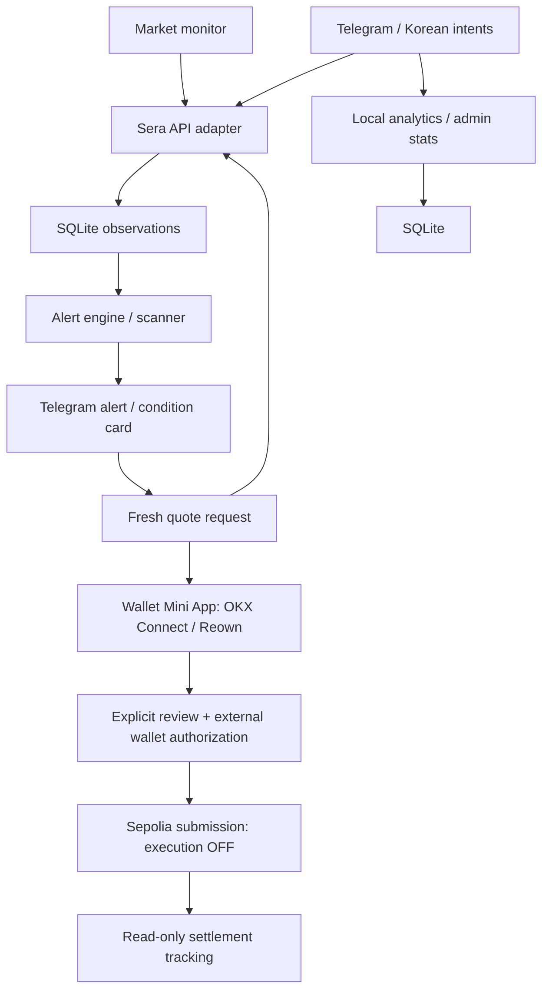

# FX Alert Bot

A Korean-first FX monitoring, alerting and user-controlled Telegram trading interface powered by Sera Protocol.

환율과 거래 가능 규모를 확인하고, 원하는 FX 조건이 오면 Telegram으로 알려드려요.
한국어가 기본이며 영어 명령어와 화면도 지원합니다.

**Market monitoring → notable FX condition → Telegram alert → fresh quote → explicit confirmation → Sera trade flow.**

- 📊 Sera FX market monitoring
- 🔔 Persistent personal FX alerts
- 🔎 `/alpha` market-condition discovery
- 🇰🇷 Korean natural-language requests
- 💱 Fresh Sera quotes
- 👛 Telegram Mini App wallet UX with verified OKX mobile connection; MetaMask acceptance pending
- 🧪 Verified Sepolia funding and transparent Permit / Intent authorization review
- 📊 Growth funnel analytics
- 🛡 User-controlled execution; no server-held private keys or auto-trading

Telegram: [@world_fx_alert_bot](https://t.me/world_fx_alert_bot) · Repository: [sunmool25x/fx-alert-bot](https://github.com/sunmool25x/fx-alert-bot)

**Execution is OFF.** The Sepolia trade architecture exists, but actual submission and settlement are not yet live verified.
Mainnet is rejected. This is an experimental MVP, not an audited trading release.

## Current status

**First real OKX Permit signing verified on Sepolia; Intent signing and swap settlement remain pending.**

The Sepolia test-token claim is finalized and reconciled. Historical read-only discovery found **2 test USDC → XSGD** to be the smallest successful tested quote; later acceptance uses an explicitly selected **50 test USDC** request. The first real owner-approved OKX ERC-2612 Permit is now **cryptographically VERIFIED**, encrypted and persisted, separately from execution. [Phase 7M](PHASE7M.md) records the original digest, exact fields, read-only chain checks and next-stage blockers. Its Quote and Permit have expired; the signature and financial lock remain preserved and cannot be reused for another Quote. **Intent signing and swap settlement remain unverified; execution stays OFF.** A Permit is financial authorization even when swap execution is disabled; quote expiry alone does not revoke it, and an established allowance survives Permit expiry. See [current status](STATUS.md) for the separate earlier UNKNOWN/invalid requests and their immutable history.

| Evidence | Scope |
|---|---|
| **LIVE TESTED** | Sera read-only markets, rates and quotes; Telegram mobile Mini App; OKX Web3 Wallet handoff, connection, ownership verification and one exact 50-USDC Permit signature (now expired). |
| **AUTOMATED TESTED** | Alerts/cooldowns/persistence, scanner, fresh quote callbacks, Korean NLU, analytics, wallet boundaries and trade safety/state machine. |
| **NOT YET LIVE VERIFIED** | MetaMask real-device connection; Telegram Desktop wallet flow; actual Sepolia swap submission; end-to-end settlement. |
| **DISABLED** | Execution in the development launcher, mainnet and automatic trading. |

The earlier invalid October 11 callback remains retained separately; [Phase 7L](PHASE7L.md) corrected its missing wire-domain schema. The later successful Permit confirms that repair on mobile. The full trade path still needs Intent wire-domain and durable signature-state work, coordinated locks, and realistic timing validation before a separately authorized execution stage. No new signature is requested by Phase 7M.

Telegram mobile + OKX Wallet connection and ownership verification were successfully owner-tested.
This does not establish full wallet acceptance: the latest combined ownership tap, cancellation/recovery,
additional client/theme coverage, phone alert delivery, Korean NLU and `/stats` remain separate checks.

Read-only probes and mocked Telegram tests do not prove phone delivery or a completed trade.
See [STATUS.md](STATUS.md) for dated evidence and [ACCEPTANCE.md](ACCEPTANCE.md) for remaining checks.

## Sepolia verification

The real OKX mobile connection and ownership signature were verified. One owner-approved testnet faucet claim succeeded, finalized, and was independently reconciled against the exact transaction, receipt and resulting test USDC/XSGD balances. Duplicate-claim protection and read-only status refresh are tested; wallet fee repricing is reconciled within the reviewed total cost ceiling.

**TESTNET CLAIM VERIFICATION:** [successful Sepolia claim receipt](https://sepolia.etherscan.io/tx/0x0f71ead97bceb8e83b4de1e7b4eae9ef5a9f933f0f2cd5de25100c5d4a486448). This is funding evidence, **not a swap**. The explorer exposes public transaction participants; the active wallet is not repeated here.

The latest bounded USDC/XSGD quote matrix found **2 test USDC** to be the smallest successful forward sample. Liquidity and costs can change; quote availability does not establish total market depth or guarantee execution. [Detailed results](PHASE7D.md#observed-liquidity-envelope) include both directions. Korean/English authorization review and the current **772-test suite** are verified. One real mobile 50-USDC Permit is verified; Intent signing, relayer submission and swap settlement remain pending with documented implementation blockers.

| Feature | Verification status |
|---|---|
| Sera market data / fresh quotes | Read-only verified |
| Telegram bot / Mini App | Verified in local live testing |
| OKX mobile connection / wallet ownership proof | Verified; proofs expire and must be renewed |
| Sepolia faucet claim / balance reconciliation | Finalized and verified on-chain |
| USDC → XSGD executable quote | Observed at 2/5/10/25/50/100 test USDC; time-specific evidence |
| Permit / Intent review | Implemented; automated tests verified |
| Real Permit / Intent mobile signatures | First valid 50-USDC Permit independently verified and encrypted; expired package retained and locked. Intent pending. See [Phase 7M](PHASE7M.md). |
| Relayer submission / real Sera swap settlement | Pending |
| MetaMask / Telegram Desktop acceptance | Pending |
| Stable production deployment | Pending |
| Mainnet trading / current swap execution | Disabled |

This is an independent community build. Integration references: [Sera Protocol documentation](https://docs.sera.cx/) and [official Sepolia developer documentation](https://docs.testnet.sera.cx/). No official endorsement or Sera Community XP credit is claimed. [Sera Community](https://community.sera.cx/) describes GitHub connection for building and automatic counting on the next daily scan. Publication makes the build available for discovery; account linking, eligibility and actual dashboard credit must be checked separately.

Dependency audit: **3 moderate package findings, 0 high, 0 critical**, unchanged in the existing OKX dependency chain. See [reconciliation validation](CLAIM_FLOW.md#reconciliation-correction) for details; these findings are not resolved by this publication.

## Why it's different

Many Telegram trading flows begin with **user wants to trade → opens bot → requests trade**.
FX Alert Bot adds **market monitoring → condition detected → Telegram alert → fresh quote → explicit user action**.

Proactive discovery and personal alerts create a reason to return when a desired condition appears.
Korean wording explains what changed and why a condition appeared; the user controls every next step.
Conditions are not investment advice or guaranteed profit.

## Install

Requirements: **Node.js 24.x**, npm and Git. Windows PowerShell is tested.
Telegram needs your own BotFather token; automated tests and compilation need no credentials or `.env`.

```powershell
git clone https://github.com/sunmool25x/fx-alert-bot.git
cd fx-alert-bot
npm install
Copy-Item .env.example .env
```

On macOS/Linux, use `cp .env.example .env`. Preserve an existing `.env` instead of overwriting it.
Keep the lockfile; subsequent reproducible installs can use `npm ci`.

Configure local `.env`:

- `TELEGRAM_BOT_TOKEN`: create a dedicated bot with **@BotFather → /newbot**.
- Keep `SERA_NETWORK=sepolia`, `ENABLE_MAINNET=false`, `ENABLE_TESTNET_EXECUTION=false`.
- For wallet testing: your own `SEPOLIA_RPC_URL`, dedicated `WALLETCONNECT_PROJECT_ID` from [Reown Dashboard](https://dashboard.reown.com/), and tester ID in `EXECUTION_USER_IDS`. Allowlisting does not enable execution; this bot's `/wallet` displays your Telegram ID.
- For `/stats`: configure admin and internal-tester exclusions using [Growth analytics](GROWTH_ANALYTICS.md#owner-reporting-and-exclusions).

Read-only commands do not require a wallet, Reown ID, Sera API key or private key.
Never share tokens, seed phrases, private keys or `.env` in chat/issues.

`DATABASE_PATH=./data/bot.sqlite` is created and migrated automatically on successful startup.
The directory must be writable; existing upgrades create consistent backups.
Databases and backups stay local and ignored.

## Start Live Testing

After configuring `.env`, run:

```powershell
npm run dev:live
```

The launcher runs tests/typecheck/build, obtains temporary HTTPS, starts one bot and checks readiness.
It preserves `.env` and always forces **Sepolia, execution OFF and mainnet OFF**.
Keep the terminal open; Ctrl+C stops its managed bot and tunnel.

Open your bot's private chat, send `/start`, and use `/wallet` for the Mini App.
Do not run another polling process with the same token.
A pasted external-browser URL is not authenticated wallet access.

An empty Reown origin allowlist permits other origins to consume that project's quota.
Use a separate temporary-development project, or a stable HTTPS origin with its exact allowlist.
See [launcher/troubleshooting](ACCEPTANCE.md#live-acceptance-setup) and [connector setup](OKX_CONNECT.md#telegram-and-wallet-connector-setup).

Missing credentials fail startup with a sanitized message; they do not prevent compilation.
Follow [ACCEPTANCE.md](ACCEPTANCE.md) before any separately authorized transaction session.

## Commands

Commands operate in private chats. Korean is the default; `/language` selects English.

| Command | Purpose |
|---|---|
| `/start` | Introduction, settings and optional acquisition source |
| `/markets [USDC]` | Registered FX pairs, optionally filtered by a token |
| `/rate [USDC XSGD]` | Currency reference rate and source timestamp |
| `/quote [100 USDC XSGD]` | New amount-specific read-only quote |
| `/liquidity [USDC XSGD]` | Quote checks at configured trade sizes; not total depth |
| `/alpha` | Notable FX conditions with transparent reasons |
| `/alert` | Pair, condition and monitoring amount; review and confirm |
| `/alerts` | Your alerts, state, latest status and management buttons |
| `/deletealert` | Select an alert and confirm deletion |
| `/wallet` | External-wallet connection, verified address and trade status |
| `/balance` | Actual supported test-token wallet balances; no invented Vault balance |
| `/swap [5 USDC XSGD]` | Quote/preparation flow; execution remains disabled |
| `/stats` | Authorized admin Growth reports |
| `/language` | Korean / English |
| `/help` | Commands, glossary and privacy guidance |
| `/cancel` | Exit the current input wizard |
| `/forget` | Confirm deletion of stored personal bot data |

Slash pairs work: `/quote 100 USDC/XSGD`.
Use plain decimals without commas/exponents; excess precision is rejected.
A registered market does not necessarily have a valid quote at every size.
Limit orders, Vault operations and transfers are not implemented trading features.

## Korean natural-language requests

- “USDC/XSGD 환율 알려줘” — reference rate.
- “100 USDC를 XSGD로 바꾸면 얼마 받아?” — fresh read-only quote.
- “USDC/XSGD가 1.35 넘으면 알려줘” — target alert draft; asks for amount, then explicit confirmation.
- “6시간 동안 0.5퍼 이상 움직이면 알려줘” — movement alert using recent pair context.
- “지금 볼만한 FX 조건 있어?” / “내 알림 보여줘” — existing scanner / alerts.
- “USDC 5개 XSGD로 바꾸고 싶어” — quote only; wallet/trade steps require their own actions.

Parsing is deterministic and local: no LLM, external AI request or conversation-body logging.
Missing/ambiguous fields receive a follow-up. Pair context expires after five minutes and is lost on restart.
English commands/UI work; English natural-language interpretation is not implemented.
Text never authorizes spending or automatically connects a wallet.
Details: [technical reference](RESEARCH.md#natural-language).

## Alert logic

Every alert has a direction and source-token amount.
Its rate is **quoted minimum output ÷ input**, including costs in Sera's `receive_less` mode.
It differs from the currency reference displayed by `/rate`.

| Condition | Meaning |
|---|---|
| Target rate | Quoted rate reaches your selected above/below target |
| Trade-size availability | A valid positive-output quote becomes available for your amount |
| Rate movement | Absolute change reaches your percentage over 1, 6 or 24 hours |
| Availability recovery | Previously unavailable quote at that size becomes available again |

The first valid sample primes state. Notifications require an observed false → true crossing.
Remaining true does not repeat; false rearms. Default cooldown is one hour.
Crossings during cooldown are consumed; expiry alone does not send a delayed alert.
Errors are unknown, not unavailability, and never trigger or rearm.

Movement uses actual same-direction/same-amount observations; missing history is not fabricated.
The shared monitor defaults to a 60-second delay after each cycle, with configurable pacing/budgets.
Triggers/outbox persist. Delivery is bounded/recoverable, but ambiguous Telegram acknowledgements can cause duplicates.

Spread alerts are unavailable because verified bid/ask data is missing.
“거래 가능 규모” means a valid quote at a stated size, not total liquidity or guaranteed execution.
Details: [conditions](RESEARCH.md#alert-logic), [monitor/delivery](RESEARCH.md#background-monitor-and-delivery).

## `/alpha` discovery and fresh quotes

`/alpha` reads recent stored Sera observations for configured probes.
It shows quoted-size availability, observed recovery and qualifying 1/6/24-hour movements.
Cards explain direction, size, change, reason and last check.

Coverage is a limited configured sample set. Feed reads do not make new Sera requests.
Missing/stale data produces an honest partial or empty feed.
No competitor comparison, profit prediction, guaranteed arbitrage or personal-threshold exposure is used.

**최신 Quote 확인 / Check latest quote** always requests a new quote.
Conditions may have changed since the alert; the card shows minimum received, rate, provided costs and expiry.
Missing cost/slippage data is not invented. A wallet trade needs its own fresh wallet-bound quote and review.

**알림 설정** prefills a draft; only **알림 만들기** saves an alert.
**테스트 거래 계속** is navigation, not financial consent.
Details: [freshness/ranking](RESEARCH.md#scanner-freshness-ranking-and-api-load), [manual checks](ACCEPTANCE.md#testing-alpha-locally).

## Architecture and Sera integration

**TypeScript + grammY + SQLite**, with a Telegram Mini App.
OKX Wallet uses official **OKX Connect**; MetaMask uses **Reown / WalletConnect**.



The official Sera testnet REST adapter validates Sepolia configuration.
Catalogs/reference data are cached; fresh quotes are not reused. Requests share pacing/Retry-After handling.
Only the gated trade service has submission capability; market/scanner/notification workers cannot sign or submit.
No MCP runtime or shared operator Sera API credential is used.

SQLite persists users, alerts, observations, outbox, wallet references, trade state and local analytics.
Node 24's SQLite API is used; PostgreSQL and multiple-instance coordination are not implemented.
API/contract details: [RESEARCH.md](RESEARCH.md), [PHASE4_CONTRACT.md](PHASE4_CONTRACT.md), [OKX_CONNECT.md](OKX_CONNECT.md).

## Growth analytics

Local SQLite analytics and admin-only `/stats` measure users, discovery, alerts, quotes, wallet verification and trade stages.
Today / 7 / 30-day reports use Seoul calendar boundaries, separating unique users from events.

Main funnel: **Active user → alert created → exact trigger → fresh notification quote → trade continuation → verified testnet completion**.
Discovery funnel: **Active user → alpha feed → alpha quote → alert from the same card**.
Explicit user-owned references establish conversion; unrelated actions do not fill gaps.
Only verified `CONFIRMED` evidence counts as completion, never a click, signature, hash or pending submission.

Acquisition links such as `https://t.me/world_fx_alert_bot?start=community_a` identify content/community sources.
First valid touch is immutable; latest touch may update. There are no referral rewards/farming mechanics.
Admin/exclusion lists omit internal testers consistently without blocking their product use.

Analytics stores operational references, source/action labels and timestamps, not message bodies, wallet addresses, balances or credentials.
Reports are aggregate; underlying operational references are not anonymous.
There is no historical backfill or external analytics service. Best-effort failures can undercount.
Definitions, setup, privacy and retention: [GROWTH_ANALYTICS.md](GROWTH_ANALYTICS.md).

## Safety and privacy

- **No server-side signer.** Private keys and seed phrases never belong in the bot.
- **No automatic trades.** Alerts and natural language never authorize transactions.
- Signatures require explicit user action; ownership proof is separate from token-use Permit and Sera Intent approval.
- Mainnet is rejected. Development execution stays OFF; real Sepolia submission/settlement remain unverified.
- Expiry/changed terms require fresh review; no silent resize, slippage widening or unattended signing.
- Ambiguous submissions reconcile through reads only, without automatic resubmission.

Protect private databases, backups and logs. Never publish initData, session credentials, signatures or tunnel configuration.
`/forget` deletes user-linked records after confirmation, but unresolved submissions block it; backups/Telegram history are separate.
Disconnect cannot revoke a signed permit or undo a submitted transaction.
Private reports: [SECURITY.md](SECURITY.md). Detailed gates/recovery: [ACCEPTANCE.md](ACCEPTANCE.md).

## Tests and deployment

```powershell
npm test
npm run typecheck
npm run build
```

The existing suite has **398 tests**.
Read-only checks: `sera:smoke`, `alerts:smoke`, `scanner:smoke`, `wallet:smoke`, `funding:smoke`.
These do not sign, claim tokens or submit swaps. Automated checks do not replace real-device acceptance.

Use one persistent Node 24 polling process, writable SQLite storage and secret injection.
[Dockerfile](Dockerfile) and [compose.yaml](compose.yaml) are provided; container deployment is not live validated.
Keep execution OFF. See [deployment guidance](ACCEPTANCE.md#deploy) for persistence/shutdown/scaling constraints.

## Known limitations

- Testnet liquidity changes; registered markets and historical positive probes do not guarantee new quotes.
- Prior quotes lived roughly 30 seconds; mobile financial approval within that window is unverified.
- No verified native spread/total-depth endpoint; probes do not establish an executable order book.
- Scanner history/coverage, polling gaps, budgets and delivery backlogs can delay or miss conditions.
- MetaMask real-device and Telegram Desktop remain unverified; Telegram Web is not a supported acceptance claim.
- Single process/SQLite, long polling; no webhook server, horizontal scaling, PostgreSQL adapter or web analytics dashboard.
- Missing settlement evidence can leave a trade unresolved indefinitely. Public API quotas and independent security review remain outstanding.
- Wallet SDK licensing/app compatibility need review before expansion; project MIT does not cover every dependency.

## Screenshots

Useful captures: `/start`, `/alpha`, alert notification, Korean request, wallet selector / OKX connected state, and `/stats`.

Real screenshots will be added after redacting personal Telegram/wallet identifiers.
No images are fabricated. Filenames/redaction checklist: [docs/images/README.md](docs/images/README.md).

## Sera Community

Public **original repository**, not a fork: [sunmool25x/fx-alert-bot](https://github.com/sunmool25x/fx-alert-bot).

- Description: **Korean-first FX monitoring, alerts and Telegram trading interface powered by Sera Protocol.**
- Topics applied: `built-on-sera`, `fx`, `sera`, `stablecoin`, `telegram-bot`, `typescript`, `web3`.
- Sera Community account linking and dashboard indexing are not verified by this publication task.
- Daily XP sync: pending external verification. **+300 XP is not claimed.**
- External star/fork qualification: pending; GitHub showed zero stars and forks on 2026-09-17.

Metadata: [.github/repository.json](.github/repository.json). Community credit is an external outcome.
Use the existing remote and reviewed commits; the initial publication script is not a setup step.
Optional `SERA_REFERRAL_URL` is blank/reserved for a supplied footer link; no runtime referral integration exists.

## Attribution and contributing

Haruki Kondo / mashharuki's community bot and [technical article](https://zenn.dev/mashharuki/articles/web3_sera_protocol-8) informed the architecture.
Only the precision helper from the verified MIT historical snapshot is adapted; remaining implementation is independent.
The relocated unlicensed source is not copied. This repository is not a fork.

Project license: [MIT](LICENSE). Required helper and wallet dependency notices: [THIRD_PARTY_NOTICES.md](THIRD_PARTY_NOTICES.md).
Investigation/exact sources: [RESEARCH.md](RESEARCH.md#3-repository-and-license-investigation).
Wallet SDKs retain separate licenses; their installed notices ship with the signing interface.
Contribution guidance: [CONTRIBUTING.md](CONTRIBUTING.md).

**Powered by Sera Protocol.**
