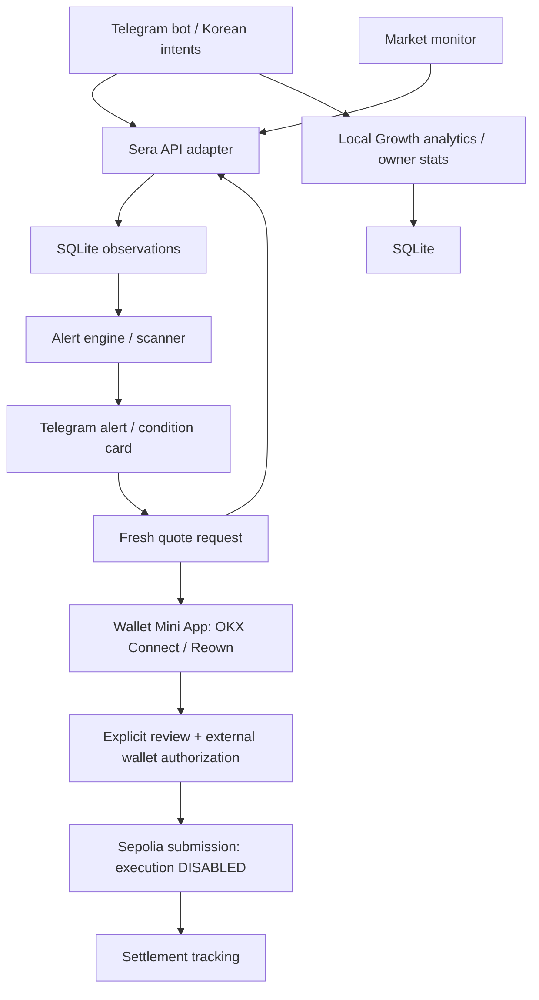

# Sera Korea FX Bot — Research
Initial research date: 2026-09-16 UTC. Phase 4.5 findings below supersede the older funding/setup unknowns; older phase reports remain historical. See [PHASE4_CONTRACT.md](PHASE4_CONTRACT.md) for the selected signing contract and [STATUS.md](STATUS.md) for evidence and acceptance status. No real wallet signature, token claim or financial submission was performed during research.

## Phase 4.5 addendum — 2026-09-17 KST

### Follow-up: one-command live setup (2026-09-17 KST)

The owner's Telegram token, one-person tester ID, migration-4 database and Sepolia RPC were rechecked successfully. The missing Reown Project ID made the original `wallet.ready` false, and `src/index.ts` used that flag to decide whether to create the HTTP server. Thus `signingUi:false` was a **local startup gate**, not an unbuilt frontend or proof that the configured HTTPS origin was malformed. Public HTTPS also failed while that local server was absent.

The revised configuration distinguishes `uiReady` (origin + RPC) from connector readiness (also requires a correctly formatted owner Project ID). The original authentication/CSRF/ownership/execution gates remain in place. An authenticated setup page may load without Reown; it still offers no wallet connection or financial authorization until required configuration is present.

Official sources checked for the development workflow:

- [Reown Ethereum Provider](https://docs.reown.com/advanced/providers/ethereum) explicitly requires an owner dashboard `projectId`. Runtime metadata must use the actual public origin; sending localhost metadata for a Telegram HTTPS page is not a valid workaround.
- [Reown Relay](https://docs.reown.com/cloud/relay) documents that localhost/127.0.0.1 is always permitted, an empty allowlist permits all origins, and updates can take 15 minutes. The chosen minimal setup is a **new, separate temporary development project with its default empty origin allowlist**. This does not bypass project authorization or alter an existing project's settings. It allows other origins to consume that public project's quota; restricted ongoing use should use a stable owned origin and an exact allowlist. No project/relay authorization has been live verified because no owner Project ID exists yet.
- [Cloudflare Quick Tunnels](https://developers.cloudflare.com/cloudflare-one/networks/connectors/cloudflare-tunnel/do-more-with-tunnels/trycloudflare/) support random public HTTPS origins for local development without a Cloudflare account/domain. [Official cloudflared CLI source](https://github.com/cloudflare/cloudflared/blob/master/cmd/cloudflared/tunnel/cmd.go) and installed CLI help confirm the explicit URL/config/protocol behavior. The launcher isolates its config, preserves Host, uses non-debug logs and automatic protocol selection. Forced HTTP/2 failed on this Windows connection; automatic protocol selection registered and passed real public health/page reads. No TLS verification was disabled.
- [Telegram Mini Apps](https://core.telegram.org/bots/webapps#inline-button-mini-apps) use the bot's current inline Web App URL without `/newapp` or Login Widget `/setdomain`. The launcher can update an existing menu only when its URL is an old Quick Tunnel; it preserves unrelated/stable menus. No Telegram messages are sent as a setup test.

`npm run dev:live` owns tests/build, Cloudflare provisioning, temporary runtime origin, bot startup, readiness probes and Project-ID-triggered reload. Runtime state contains only public coordinates in ignored `.dev-live/`; `.env` is not modified. It always forces Sepolia/execution-OFF/mainnet-OFF. Official Windows downloads are checked against GitHub's SHA-256 release digest. Cloudflare/build subprocesses do not receive bot credentials. Private Node IPC supports Windows shutdown; no HTTP control/authentication bypass was added.

**LIVE CHECKED:** real bot initialization and Telegram API reads, local companion, automatic Quick Tunnel registration, public HTTPS health and the unauthenticated signing page, active-runtime preflight, Ctrl+C cleanup, released local port, unchanged `.env` and database integrity. **MOCK/LOCAL TESTED:** valid-format Project ID configuration path, cancellation/security regressions and optional menu updating. **OWNER REQUIRED:** Reown account/project, actual relay authorization, native Telegram authentication and wallet consent. No real wallet connection, signature, claim or swap occurred. The earlier Phase 4.5 funding evidence below remains unchanged.

The available browser's actual [Reown Dashboard](https://dashboard.reown.com/) showed its Sign In/Google/Sign Up screen. There was no authenticated account context to obtain/create an owner project. No consent or login was performed; the account gate was observed rather than inferred solely from missing local configuration.

### Exact supported funding path

The claim-review hold below is a **historical research checkpoint**. The subsequent transparent in-app claim succeeded and finalized; see [claim reconciliation](CLAIM_FLOW.md#reconciliation-correction). Current quote discovery and prepared financial review are in [PHASE7D.md](PHASE7D.md). No real Sera swap has been submitted or settled.

**Owner claim-review investigation, 2026-09-17 04:37 UTC:** a fresh copy of the explorer-verified IssueTestTokenV3 source confirms claim() -> _claimTo(msg.sender) -> native ETH attempt and _processClaim(recipient). It is a combined faucet, not an ETH-only function. At Sepolia block 11721444 the configured native allocation is 0.01 ETH and claimAmount is 10^15 raw units; USDC and XSGD both have six decimals, so their individual allocations are 1,000,000,000 mock token units. A read-only eth_simulateV1 sequence for the private hash-bound acceptance wallet, with claim() followed by balanceOf on both exact contracts, succeeded and returned both balances increased from zero to those allocations. This did not sign, submit, reserve stock or change chain state. The owner's OKX review reported only +0.01 ETH; why its UI omitted token deltas is unknown. Neither that display nor our simulation verifies the actual phone request's destination/calldata. Approval remains on hold until they match Sepolia, the faucet below, data 0x4e71d92d and zero transaction value. ETH delivery excludes gas costs; actual receipts and exact balance changes must still be checked after any separately owner-approved claim. Mainnet and swap execution remain OFF.

| Classification | Evidence and practical limit |
|---|---|
| **DOCUMENTED** | Official [Sera quickstart](https://docs.testnet.sera.cx/quickstart/) links the [Sepolia faucet at 0x4FAc3BB8B77547E2Da7ed903baDBeD2f46cBe65a](https://sepolia.etherscan.io/address/0x4FAc3BB8B77547E2Da7ed903baDBeD2f46cBe65a#code). Its explorer-verified IssueTestTokenV3 source/ABI exposes public `claim()` and `hasClaimed(address)`. `claim()` sends to the caller; eligibility is once per claim epoch, not an admin-only mint. It also exposes token list, allocation and ETH amount reads. Insufficient stock may defer assets, so a successful receipt alone does not establish all balances. |
| **LIVE CHECKED — public reads** | At **2026-09-16T18:33:42.077Z**, chain 11155111, claim epoch 2 and 117 faucet tokens were read through public Sepolia RPC. The exact registry USDC and XSGD below were both included and had sufficient faucet token stock for the configured claim. `claimAmount` was 1,000,000,000,000,000 raw units: 1,000,000,000 mock units for each six-decimal token. Configured ETH per claim was 0.01; faucet native ETH stock was 2.08. This is a stock snapshot, not a reserved allocation. |
| **LIVE CHECKED — simulation only** | At **2026-09-16T18:34:19.541Z**, `hasClaimed` for the public burn probe address was false and an `eth_call` simulation of `claim()` returned successfully. No signature, transaction, transfer, real user address or chain-state modification occurred. This establishes that the public claim path was callable in simulation at that moment; it does not prove an actual owner claim. |
| **LIVE CHECKED — official app landing** | The official [testnet site](https://testnet.sera.cx/) links [app.testnet.sera.cx](https://app.testnet.sera.cx/swap). Its wallet page asks users to sign in before viewing/claiming tokens. The browser was inspected without connecting a wallet. |
| **UNKNOWN — owner participation required** | Owner eligibility, current gas estimate, actual faucet transaction and received balances; signed-in app claim behavior; wallet connector authorization and mobile return. These must be checked by the owner in ACCEPTANCE.md. |
| **UNAVAILABLE** | No unauthenticated token-claim control was exposed on the inspected app wallet page. No separately documented faucet REST endpoint was established or invented. This does not label the verified on-chain faucet unavailable. |

The funding method is the official-linked contract's **no-argument `claim()`**, called by the owner from the same Sepolia EOA. It requires some native Sepolia ETH up front for gas; do not assume the faucet's later ETH transfer pays that transaction's initial cost. The official quickstart also links [sepoliafaucet.com](https://sepoliafaucet.com/) for native test ETH. No account eligibility or successful claim on that service was tested. If free ETH/claim access is unavailable, request official Sera test funding assistance using only the public address; do not buy assets or bypass restrictions. [ACCEPTANCE: supported test tokens](ACCEPTANCE.md#obtain-the-exact-supported-test-tokens) gives the manual steps. No automated claim method was added.

The single acceptance pair remains **USDC → XSGD**:

- USDC: `0x965d4b4546716e416e950bc30467d128455d2d0e`, six decimals.
- XSGD: `0x058e06ca2628165a6cd1e80e4dc82203dc0020aa`, six decimals.
- At **2026-09-16T18:34:17.911Z**, `wallet:smoke -- --amount=5` obtained a positive 5-test-USDC quote and verified deployed roles, live permit metadata, on-chain Intent digest, balances and finalized/bounded logs. The quote taker was a public burn address; no wallet or signature was used. A 1-USDC probe shortly before returned UNAVAILABLE. **5 is the smallest successful amount checked, not a protocol minimum**; it is a starting point for a new owner quote, not a promise of current liquidity. The 100-test-USDC ceiling is unchanged and may be lowered.
- The faucet evidence supports retaining this pair. There is no evidence requiring an execution-pair switch; no pair was added.

`scripts/funding-smoke.ts` performs only public ABI reads and stock checks. It deliberately does not claim or simulate owner eligibility. `scripts/wallet-smoke.ts` accepts a bounded optional amount for read-only probing. Neither can submit a swap. The temporary public RPC used was `https://ethereum-sepolia-rpc.publicnode.com`; it was not written into the user's `.env`. TLS verification stayed on with the Windows system CA store.

At **2026-09-16T18:58:00.061Z**, the new RPC readiness probe independently passed against that public endpoint: Sepolia/deployed domains, finalized block, an actual public transaction receipt and bounded event logs. This is **LIVE CHECKED** RPC capability; it does not establish an owner swap or complete the still-missing Telegram/origin/project setup.

### Telegram, HTTPS and Reown setup findings

- **DOCUMENTED:** [Telegram Inline Button Mini Apps](https://core.telegram.org/bots/webapps#inline-button-mini-apps) support this repository's private-chat `web_app` button. Its HTTPS URL is generated from SIGNING_ORIGIN. `/newapp`, Main Mini App registration and Login Widget `/setdomain` are not prerequisites for this launch path. A [menu button](https://core.telegram.org/bots/webapps#menu-button-mini-apps) is optional; if configured with `/setmenubutton`, it must use the same current origin. Preflight checks Telegram `getMe`, `getWebhookInfo` and the default `getChatMenuButton` without mutation. It cannot verify every per-user menu override; the owner must open the actual private-chat button.
- **DOCUMENTED:** [Cloudflare Quick Tunnels](https://developers.cloudflare.com/cloudflare-one/networks/connectors/cloudflare-tunnel/do-more-with-tunnels/trycloudflare/) provide a temporary public HTTPS hostname without an account/domain. The official [Windows download](https://developers.cloudflare.com/cloudflare-one/networks/connectors/cloudflare-tunnel/downloads/) links cloudflared. The architecture is provider-independent: forward to 127.0.0.1:8787 with original public Host preserved, no interstitial and no request-body debug logging. No tunnel, deployment or DNS was created here. **Actual Telegram → tunnel → companion connectivity remains UNKNOWN.**
- **DOCUMENTED:** [Reown relay setup](https://docs.reown.com/cloud/relay) uses the dashboard project ID and origin allowlist. Exact origin matching is preferred; changes may take 15 minutes. A configured ID is public configuration, not financial authority. No owner project was created or invented. **Actual relay authorization remains UNKNOWN** until real wallet pairing.
- **Intended, NOT LIVE VERIFIED:** native Telegram Desktop/Android/iOS. Bare external-browser links have no trusted initData and are rejected. Telegram Web may embed the app cross-site; this MVP's strict session cookie is not claimed compatible with that environment. Native mobile wallet-return behavior needs owner testing. `WALLET_RETURNED` is a visibility diagnostic, not proof of authorization.

### Phase 4.5 implementation boundary

Execution-OFF preview uses the existing wallet-specific quote validation but creates no durable financial authorization/version/attempt and returns no signable payload. Enabling execution later requires a **new** quote/review and explicit consent. Connection requests only an ownership message; Permit and Intent remain separate explicit financial approvals. Manual status refresh is wired solely to the read-only settlement worker and respects its concurrency/backoff. Unknown submission is never retried. Stable safe errors and ephemeral HMAC-redacted diagnostics support owner reports without raw initData, wallet signatures or credentials.

No Sera endpoints were invented, no runtime MCP added, no dependency upgraded and no additional community implementation copied. Existing MIT reuse/Haruki attribution remains unchanged. Explorer source was consulted for protocol facts and ABI signatures only; its displayed license was N/A, so its protected implementation was not copied. Phase 5, analytics and execution-scope expansion remain excluded.

## Phase 4 addendum — 2026-09-17 KST

### Evidence classifications

- **DOCUMENTED:** official [testnet API](https://docs.testnet.sera.cx/api-reference/), [authentication](https://docs.testnet.sera.cx/api-reference/authentication/), [swap endpoint](https://docs.testnet.sera.cx/api-reference/endpoints/swaps/), [orders](https://docs.testnet.sera.cx/api-reference/endpoints/orders/), [SOR](https://docs.testnet.sera.cx/contracts/sor/), and [quickstart](https://docs.testnet.sera.cx/quickstart/). Also inspected current developer docs, agents documentation and official GitHub linked below. REST remains the only Sera API integration; no MCP or agent runtime was added.
- **LIVE READ-ONLY VERIFIED:** public Sepolia API/RPC check at **2026-09-16T17:32:59.628Z** using `scripts/wallet-smoke.ts`. Live configuration, deployed code/contract roles, token decimals, a positive 100 USDC → XSGD probe, permit domain/nonce, on-chain Intent digest, token balance reads, finalized block and bounded event-log query passed. Probe owner was the public burn address; no user wallet, signature or POST /swap. HTTPS used the Windows system CA store with verification enabled.
- **MOCK-TESTED:** Telegram authentication/replay, SIWE ownership, endpoint isolation, exact quote/version consent, signature validation, execution gates, concurrency, restart recovery, receipt evidence, reorg quarantine, notifications, database migration/backup and Korean/English routes. Cryptographic test signatures use fixed, publicly known test-only keys. They are never network identities.
- **LIVE USER-VERIFIED:** none. Telegram chat delivery, wallet connection/mobile return, real signatures, a submitted swap and its final receipt remain owner acceptance work.
- **UNRESOLVED:** current faucet eligibility and exact test-USDC distribution; real mobile completion within the short quote window; status of an accepted request that never produces an event; numeric Sera rate quotas before scaling. These are not recorded as successful checks.

### REST, deployed roles and exact signing contract

API base is `https://api.testnet.sera.cx/api/v1`, chain **11155111**. Live configuration supplied:

| Role | Sepolia address |
|---|---|
| Sera / Intent verifying contract | `0x83475A1bD98a8DC2DCd507A747e4DC85da241D6e` |
| SOR / permit spender | `0x83c1368110B640A729f3810De5FBe94b99aa5668` |
| Vault | `0x3c7945840bAE0d7e7f3824Ebccef1962629250F0` |
| Supported input USDC | `0x965d4b4546716e416e950bc30467d128455d2d0e` |
| Supported output XSGD | `0x058e06ca2628165a6cd1e80e4dc82203dc0020aa` |

Runtime protocol roles are fetched and validated against chain/domain/contract getters; arbitrary browser targets are never accepted. The two token addresses are the explicit narrow execution policy. Both have six decimals. Registry minimum was zero at inspection, but positive input/output and the current registry minimum are enforced. The local ceiling is 100 test USDC, adjustable downward; it does not treat other currencies as dollar equivalents.

Wallet-funded quote POST `/swap/quote` uses `from_token`, `to_token`, raw integer-string `from_amount`, the verified wallet as both `owner_address` and `recipient`, server-time + 300 seconds as `expiration`, and `gas_mode: receive_less`. Connection, ownership and balance/contract checks precede this final request. Monitoring quotes cannot be promoted into trades.

EIP-712 Intent domain is **Sera / version 1 / 11155111 / Sera contract**. Field order and types are `taker:address`, `inputToken:address`, `outputToken:address`, `maxInputAmount:uint256`, `minOutputAmount:uint256`, `recipient:address`, `initialDepositAmount:uint256`, `uuid:uint256`, `deadline:uint48`. Raw amounts use BigInt. The exact validated response is signed without reconstructing or changing financial terms. RPC `getIntentDigest` confirms the local EIP-712 result.

Quote cache `uuid` and the composite numeric signed `Intent.uuid` are distinct identifiers. Live responses disprove deriving one from the other; both are preserved in the immutable payload/version digest. Quote expiry was about **30 seconds**, independently of the requested 300-second signed deadline. The UI displays actual expiry and stops signing/submission five seconds early. No local extension or silent refresh is permitted.

The response supplies a required ERC-2612 Permit even if allowance already exists. Exact fields: owner, spender, value, nonce, deadline. Spender is SOR; value is only this trade's input; deadline is validated. The **live USDC domain was CIRCLE / version 1**, unlike the illustrative USD Coin / version 2 example. Domain separator and owner nonce are checked on-chain, including immediately before submission. No generic permit guessing, unlimited approvals or on-chain approval fallback is implemented.

POST `/swap` accepts `{uuid, signature, permit_signature, permit_deadline}` with public EIP-712 body authorization. A successful accepted response supplies `trade_id` and pending status; this is not completion. The dedicated endpoint reference and live quote permit metadata take precedence over quickstart examples omitting permit fields. Quickstart retry advice is deliberately not implemented: an ambiguous submission is reconciled through reads only.

### Authoritative settlement and account credentials

[Official SOR source](https://github.com/sera-cx/orderbook-contract-v2/blob/audit/src/SeraSOR.sol) defines `IntentMatched(bytes32 indexed intentHash,address indexed taker,uint256 legCount)`; [SeraBase](https://github.com/sera-cx/orderbook-contract-v2/blob/audit/src/SeraBase.sol) provides the Intent hash contract. The event binds the **struct hash**, not the full typed-data digest. Contract implementation was inspected for facts, not copied. The SOR enforces the signed recipient/output envelope before emitting the matching event.

This MVP uses public Sera contract reads for status: exact SOR event/hash/taker, a successful canonical receipt on Sepolia at or below the RPC's finalized block, positive input-token debit no greater than maximum input, and output-token transfers to the signed recipient at least equal to minimum output. A relayer or batch transaction is allowed. A transaction hash, allowance/permit or unrelated successful receipt cannot satisfy this predicate. Exact matching events plus transfer bounds are conservative; unusual batches involving additional same-wallet transfers may remain unresolved.

Scan from a persisted pre-submission block, at most 2,000 blocks and two due records per cycle, with backoff. Finalized receipts are rechecked hourly; a detected reorg quarantines that wallet and resumes reads. Finalized does not mean an absolute impossibility of reorganization. Missing evidence remains PENDING/UNKNOWN and holds the wallet's execution lock. No retry or timer-based success is allowed.

Authenticated REST GET `/orders/{trade_id}`, `/orders` and `/fills` require wallet-specific Sera API credentials. Their documentation resolves some initial Phase 0 uncertainty, but orders remain outside Phase 4 scope. The [MCP settlement tool](https://github.com/sera-cx/sera-mcp/blob/main/src/tools/settlement.ts) is a pass-through, not independent normalized settlement proof. Public token balance and event/receipt reads avoid creating/storing per-wallet API secrets. No shared operator API key is used.

Limitation: without authenticated order history, this implementation cannot automatically diagnose an accepted request that never emits its event. It remains unresolved, possibly indefinitely, for investigation using the Sera trade ID. The lock must not be cleared merely to try again. Live event-to-receipt acceptance has not been performed.

### Wallet identity, funding and dependency reuse

[Telegram Mini Apps validation](https://core.telegram.org/bots/webapps#validating-data-received-via-the-mini-app) supplies authenticated user identity through server HMAC validation, freshness and replay protection. A secure short-lived session, origin and CSRF checks protect all financial endpoints. A standard [SIWE](https://eips.ethereum.org/EIPS/eip-4361) nonce/domain/chain/purpose/expiry challenge, verified with viem, proves EOA ownership; it does not authorize spending. Financial Permit and Intent are separate visible wallet requests. Smart/delegated-code accounts are rejected.

[Reown Ethereum Provider](https://docs.reown.com/advanced/providers/ethereum) supplies the single WalletConnect QR/mobile connection path, without relying on injected extensions in Telegram. No bearer-link external-browser handoff or development authentication bypass exists. Public HTTPS, a Reown project with origin allowlist and Sepolia RPC are required. Their absence does not prevent the existing read-only bot from running.

The verified funding contract is **wallet-held registry USDC → receive_less swap**, not Vault funding. The official quickstart identifies faucet contract `0x4FAc3BB8B77547E2Da7ed903baDBeD2f46cBe65a` and the [testnet app](https://testnet.sera.cx/). Appropriate USDC availability/claim eligibility was not verified. No faucet URL, method or funding transaction is invented or executed. Live acceptance requires an already-funded test wallet or official Sera assistance; no purchase of assets is suggested.

No additional Haruki/community implementation was copied. The existing precision helper and complete MIT notice remain. New bot, authentication and trading code is independently implemented; npm libraries retain their own licenses. Installed `@walletconnect/ethereum-provider@2.25.0` uses the WalletConnect Community License and `@reown/appkit@1.8.24` uses the Reown Community License (also applicable to the provider's nested AppKit version). These are not MIT: distribution requires full agreements, Reown attribution/branding and use of their network. The included terms specify commercial licensing beyond 500 MAU or 2,500,000 monthly RPC calls, subject to vendor updates. App code retains its own rights; SDK modifications have separate obligations. SDK source is not patched. See [THIRD_PARTY_NOTICES.md](THIRD_PARTY_NOTICES.md); the build includes installed dependency agreements in the signing page's license download.

## Historical Phase 0/1 findings

## 1. Sources inspected
- [Official developer documentation](https://docs.dev.sera.cx/)
- [Official product documentation](https://docs.sera.cx/)
- [Official agents/MCP site](https://agents.sera.cx/), [API tools](https://agents.sera.cx/docs/api/), [architecture](https://agents.sera.cx/docs/architecture.html)
- [Official GitHub organization](https://github.com/sera-cx)
- [Original community bot link](https://github.com/mashharuki/SeraProtocol-Sample/tree/main/telegram-bot)
- [Haruki technical article](https://zenn.dev/mashharuki/articles/web3_sera_protocol-8)
- [Relocated community repository](https://github.com/mashharuki/Sera-Telegram-Bot)
- GitHub REST metadata, recursive trees, commit history and raw files were read directly. The original repository was not cloned or copied.
- [grammY guide](https://grammy.dev/guide/), [Node SQLite documentation](https://nodejs.org/docs/latest-v24.x/api/sqlite.html)

## 2. Community bot architecture
The article and relocated README/package manifest describe Bun + TypeScript, grammY, Hono HTTP routes, Zod schemas, LibSQL SQLite/Turso repositories, Privy server wallets, and optional Mastra/Anthropic intent handling.
The source tree separates bot commands, callbacks, conversational flows, services, Sera REST integration, utilities for precision and UUIDs, Privy signer, database, Japanese/English messages and Mastra read/prepare tools.
Users hold wallet ID/address references in SQLite. Onboarding creates a Privy server wallet and provisions a Sera API key.
Swap preparation obtains token decimals, server time and a quote; it stores an expiring pending action and shows a confirmation card.
The confirmation callback checks ownership/expiry, atomically consumes the pending action, then requests Privy signatures and submits to Sera.
Expired quotes cause a new card and another confirmation.
Limit orders use precision metadata and preview, Vault funds, signed order submission and cancellation.
Liquidity is inferred by quote probes; it is not a native depth endpoint.
AI has read/prepare tools and no direct execution tool.
The README reports in-memory conversation drafts and a single-instance deployment assumption.
The README also reports plaintext Sera API secrets, private-key import/export commands, and a cancellation typed-data assumption requiring verification. These are not acceptable defaults for our product.
The article is architectural background, not permission to copy its prose or snippets.

## 3. Repository and license investigation
The original repository current main was 47375d6bdd22adc6144b470cdf3af478c8f03aa7 when inspected.
Its root [LICENSE](https://github.com/mashharuki/SeraProtocol-Sample/blob/main/LICENSE) is MIT, copyright (c) 2026 Haruki Kondo.
The telegram-bot directory was removed by [commit 9f571d1](https://github.com/mashharuki/SeraProtocol-Sample/commit/9f571d126fa245dd89a3e8279e308b39c3b9f51f) on 2026-08-09.
Current .gitmodules points Sera-Telegram-Bot to the relocated repository.
The most recent directory-specific implementation snapshot before removal is [de12dc8](https://github.com/mashharuki/SeraProtocol-Sample/tree/de12dc8883a7fb2cdf6dd318b3860311a7b8ae44/telegram-bot).
Its root LICENSE is explicitly MIT with the same copyright. The recursive tree contains no bot-specific LICENSE/NOTICE/COPYING overrides.
MIT explicitly permits modification, distribution, sublicensing, sale and derivative reuse, subject to retaining the copyright and permission notice with copies/substantial portions, including the warranty disclaimer.
The relocated repository main was be50b4711c2665090769ebd1ac408d5629facf24. Its GitHub license metadata is null and its LICENSE returns 404. The original parent license does not establish licensing of subsequent additions in an independently hosted repository or submodule.
Therefore use only the verified MIT historical snapshot for any source reuse; do not copy current relocated source.
This is the implementation licensing policy based on the published notices, not a determination of unpublished rights.

### Reuse decision and attribution
Reuse/adapt only telegram-bot/src/sera/precision.ts from the MIT snapshot de12dc8, for exact decimal/raw-unit conversion. Retain attribution in the file and the complete original notice in THIRD_PARTY_NOTICES.md.
Add input-length/uint256/decimal validation at our service boundary. Correct the historical zero-decimal formatter edge case in the adaptation.
All bot UI, Sera adapter, persistence, alerts, scanner, monitoring, analytics, NLU and transaction authorization are independently implemented.
Do not copy Japanese/English dictionaries, Privy signing code, private-key export/import, cancellation structures or deployment scripts.
The original project's architecture is credited as inspiration in README and these findings.
Official sera-mcp and sera-agents have MIT license metadata. No code from these repositories is vendored in Phase 1.
Official contracts default to audit branch and metadata NOASSERTION; other organization repositories include unlicensed projects. Do not assume organization-wide licensing.
Our independent implementation can be released under MIT, retaining third-party notices. Dependencies retain their own licenses.

## 4. REST API surface — exact documented endpoints
Canonical documented testnet base: https://api.testnet.sera.cx/api/v1
Official sera-mcp source also uses https://api-testnet.sera.cx/api/v1 for Sepolia.
Both GET /config hosts were verified to return chain_id 11155111 with matching contract/domain configuration during research.
Production base: https://api.sera.cx/api/v1. Mainnet is disabled by default and Phase 1 contains no execution adapter.
Primary references: [testnet overview](https://docs.testnet.sera.cx/api-reference/), [system](https://docs.testnet.sera.cx/api-reference/endpoints/system/), [swaps](https://docs.sera.cx/api-reference/endpoints/swaps/), [orders](https://docs.sera.cx/api-reference/endpoints/orders/), [account](https://docs.sera.cx/api-reference/endpoints/account/), [authentication](https://docs.sera.cx/api-reference/authentication/).

| Capability | Endpoint/tool | Authentication | Product use |
|---|---|---|---|
| Health | GET /health | Public | Diagnostic readiness; executor/signature status |
| Network/contracts | GET /config | Public | Verify chain and EIP-712 domain; never hardcode contract addresses |
| Time | GET /system/time | Public | Server-relative quote/signature deadlines |
| Token discovery | GET /tokens | Public | Symbol, currency, address, decimals and minimum trade amount |
| Market discovery | GET /markets | Public | Registered pair catalog and precision; does not prove executable liquidity |
| Reference FX | GET /fx/rate?base=USD&quote=EUR | Public | Reference rate, as_of and nullable historical change; not executable token price |
| Swap pricing | POST /swap/quote | Public | Amount-specific, wallet-bound route and short-lived UUID |
| Batch pricing | POST /swap/quote/batch | Public | Up to 50 quotes; per-item outcomes, independent snapshots |
| Swap execution | POST /swap | EIP-712 Intent and applicable permit | Phase 4 only, after confirmation and external signature |
| Limit preparation | POST /orders/preview is referenced by system docs and community bot | Payload/authentication not established by current order endpoint reference | Do not implement until verified; signed POST /orders is documented |
| Limit creation | POST /orders | EIP-712 Order | Requires Vault collateral; later phase |
| Limit cancellation | POST /orders/cancel | EIP-712 | Verify published layout and live behavior before enabling |
| Cancel all | DELETE /orders/cancel-all | API key | Still an explicit user-authorized financial mutation in our design |
| VL | POST /orders/vl/batch; POST /orders/vl/cancel | EIP-712 | Supported; beyond basic MVP |
| Balances | GET /balances?owner_address=... | Wallet-scoped API key | Wallet + available/frozen Vault balances; decimals are raw strings |
| Order/fill history | GET /orders; GET /orders/{order_id}; GET /fills; GET /fills/{order_id} | Wallet-scoped API key | Reconcile pending settlement; submission success is not transaction completion |
| Permit probe | GET /permit/metadata | API key | Nonce, domain, allowance metadata |
| Approval/deposit | POST /approve; POST /deposit | API key | Unsigned transaction building, not execution authorization |
| Broadcast | POST /tx/send | API key and signed raw transaction | Later phase; never unattended signing |
| Transfer | POST /transfer; POST /transfer/send | API key | Build/broadcast; beyond initial scope |
| Withdraw | POST /withdraw; POST /withdraw/build; POST /withdraw/send | Signature/optional API key per stage | Dual-signature flow; beyond initial scope |
| API key management | POST /api-keys and documented list/revoke variants | EIP-712 or key depending variant | Future wallet onboarding; protect secrets |

POST /orders/preview is mentioned in market documentation but lacks a full request/authentication section in the inspected current orders reference, and the inspected official MCP client/maker module does not wrap it. It was not live-called. Do not infer that the community implementation proves its current authenticated schema.
No native public order-book/depth endpoint was identified. Do not invent /depth, /price, /swap/execute, or /history endpoints.
Reference rates cannot substitute for amount-specific executable rates.

### Quote wire behavior
Required request: from_token, to_token, from_amount (positive raw uint256 string), owner_address, recipient, expiration. Optional gas_mode receive_less/pay_more.
Use GET /system/time for expiration. Quote UUID lifetime is approximately 30 seconds, separate from Intent deadline.
route_params is the Intent message, not a complete typed-data object. Obtain its domain from live GET /config and sign unchanged values with documented types.
minOutputAmount=0 means informational/non-executable even if HTTP 200.
fee_breakdown documentation promises gas cost only. Live responses additionally contained quote_breakdown and route_metadata. Treat extra fields as optional; do not advertise a complete fee/slippage decomposition.
receive_less preserves input and incorporates costs into output. Do not subtract gas twice.
A burn-address probe follows official MCP simulate behavior. It is a read-only price/liquidity probe, not an executable user-wallet quote. There is no documented REST simulate flag to invent.
The eventual external-wallet quote must be freshly issued for the authenticated user's actual wallet.
Permit fields can be required even when allowance exists; use the API-provided permit typed data. Unsupported permits require explicit approve signing.
POST /swap returns success plus pending status/trade_id; reconcile chain receipt and settlement status before recording completion.
Some docs recommend silent re-submit after stale quote. Our stricter product rule prevails: new pricing always requires another user review/confirmation.

## 5. Agents/MCP tools
The agents site advertises v0.4.0 and 32 tools; the current official repository has additional registry/modules. Treat website counts as a versioned snapshot, not runtime guarantees.
Relevant advertised tools:
- list_currencies, get_markets: catalogs.
- get_fx_rate: Sera reference FX.
- get_quote(simulate:true): burn-address probe; prepare_swap: unsigned preparation; execute_swap: signed submission.
- scan_markets, probe_depth, infer_book, round_trip_cost: quote-derived availability/depth/cost, not a published book.
- get_balances, settlement_status: authenticated wallet/settlement reads.
- fx_history, fx_volatility: locally collected observations, not native historical candles.
- doctor: connectivity/network/policy checks.
- limit_watcher: polling helper, not a resting limit order.
- Current source includes maker_orders/health_corridors/registry modules; published availability depends on build and configuration.
Not used: competitor comparisons, find_deals' external-mid ranking, compare_to_external_fx, maker hedge claims, triangular arbitrage messaging, unattended convert_and_send, or x402 vault execution.
Our /alpha uses only Sera observations/reference data and user conditions. No profit/arbitrage claim.

## 6. Live read-only findings
All probes below used the official burn address; no wallet authorization, signing, /swap or /orders mutation occurred.
- GET /config: Sepolia 11155111; EIP-712 domain chainId matches.
- GET /tokens: 117 entries; GET /markets: 6,786 entries. Counts can change.
- GET /fx/rate USD/EUR: HTTP 200, rate 0.85848, change_pct 0.1260 with source timestamps at inspection. These are historical research findings, not current trading quotes.
- 100 USDC -> EURC: HTTP 400 detail.success=false, detail.error=no_liquidity.
- 100 USDC -> XSGD: HTTP 200 with positive minOutputAmount 123544048 at six output decimals.
- 1,000,000 XIDR -> USDT: HTTP 200 with positive minOutputAmount 54219399 at six output decimals.
These individual outcomes establish adapter feasibility, not coverage or price guarantees.
Haruki's README reports near-zero Sepolia swap liquidity in July; today's limited positive probes show that statement cannot be used as a current universal limitation.
Failures must distinguish no liquidity, below minimum, unknown data, throttling and transport outages.

## 7. Proposed exact architecture
Runtime: Node.js 24 LTS + TypeScript ESM + grammY + Zod + decimal.js.
Persistence: SQLite with Node DatabaseSync, WAL, busy timeout, foreign keys, versioned migrations; async repository interface allows future PostgreSQL adapter.
One long-polling bot instance initially; no deployment or Telegram webhook changes during development.
src/bot/: Telegram adapter, commands, private-chat/ownership checks, conversational UI and buttons.
src/sera/: allowlisted REST client, schemas, market/rate/quote/liquidity service, exact precision.
src/config/: environment parsing, testnet-first safety policy.
src/database/: migrations, repositories, persisted users/conversations/quote intents.
src/i18n/: Korean-first natural product wording, English alternatives and glossary.
src/utils/: bounded caches, serialized request pacing, safe errors.
Future phases add src/alerts/, src/scanner/, src/wallet/, src/analytics/ with working implementations at their phase gates, not placeholders advertised as features.

Phase 2: alerts, states, trigger records and delivery outbox. Worker uses environment poll/cooldown, request budget, bounded pair rotation, backoff, safe caches and persisted observations.
Dedup plan: evaluate false->true crossing; keep condition-active state and last trigger time, rearm on false; cooldown blocks repeated notifications. Transactionally persist trigger + outbox with unique dedup key. Retry deliveries with Telegram limits; exactly-once external message delivery is not guaranteed after a crash/ambiguous response.
Phase 3: transparent baseline/target/movement/availability/liquidity signals. Require adequate observations and freshness; no inferred profit.
Spread: if no direct bid/ask primitive, explicitly name quote-derived two-sided cost/spread at stated sizes, gas included. Never represent independent probes as an atomic executable book.
Liquidity alert: exact size must return positive output under configured rate-impact tolerance; largest sampled size is a lower bound only, not total depth. USD equivalents only via supported Sera currency reference data.
Phase 4: Telegram alert button -> amount -> NEW wallet-bound quote -> detail card -> explicit confirmation -> authenticated external-wallet signing page (Telegram init-data/auth binding + wallet ownership proof) -> unchanged Intent/applicable permit signatures -> one signed Sepolia submission -> settlement/receipt reconciliation. No server private key, Privy app-controlled signing, auto-signing, unattended authorization or mainnet default.
Quote TTL may expire during signing: fetch a new quote and require another explicit confirmation. Bind action to Telegram user, wallet, recipient, network, amount, quote UUID, expiry and consumed state.
Phase 5: deterministic Korean NLU first; ambiguous input asks for fields. Structured read/prepare actions only, same confirmation path. Optional LLM has no signer/mutation capabilities.
Phase 6: aggregate funnel events, source attribution and admin-only /analytics. Store operational Telegram IDs only, no names, phone numbers, message history or location. Korean UI language indicates language preference, not verified Korean nationality.

### Database roadmap
Phase 1: users(id, language, source, created_at, last_seen_at), conversations(user_id, JSON state, expiry), quote_intents(id, user_id, token addresses, amount, expiry).
Phase 2 migrations: alerts, alert_state, observations, triggers, delivery_outbox.
Phase 4: wallet references/proofs, pending_actions, trade_flows, completed_transactions with unique chain+tx hash and explicit confirmed settlement.
Phase 6: analytics_events (user pseudonymous reference, event type, related alert/quote/flow ID, source, timestamp). Quote viewed attribution must reference a specific trigger rather than uncorrelated total counts.
Financial amounts/rates use decimal strings; raw units use uint256 decimal strings. Timestamps UTC epoch milliseconds. Schema avoids SQLite-only JSON query requirements, keeps application logic behind repositories; PostgreSQL migration still requires a separate adapter and migration validation.

## 8. Blockers and assumptions
Phase 1 implementation has no technical blocker. Live Telegram acceptance requires a user-provided BotFather token, not yet configured in this project.
Read-only queries do not require an API key; no secret from unrelated home .env or other projects is inspected or reused.
Testnet liquidity is variable; a no-liquidity result is valid product behavior.
Public edge/CDN rate budget is not numerically published. Start with conservative configurable 500 ms request spacing, never infer the 10 req/s authenticated read budget applies to unauthenticated quotes. Verify allowance with Sera before scaling.
Reference as_of freshness and unavailable historical anchors must be visible; reference observations are distinct from executable quotes.
Phase 4 requires a hosted HTTPS signer surface, external wallet ownership/authentication, permit handling, funded testnet account and confirmed settlement receipt testing. No execution is enabled until those are verified.
Balance/order management requires user-specific API credentials or verified on-chain reads. Never share an operator wallet's Sera key across Telegram users.
Assume single process local SQLite at MVP; later horizontal scaling needs PostgreSQL/outbox leases/shared rate budgeting.
No production, growth, receipt-completion or live Telegram success claim is justified before corresponding acceptance checks.

## 9. Phase 1 implementation plan and gate
1. Write research and attribution first.
2. Set up project, environment example, strict TypeScript and Korean/English messages.
3. Implement read-only Sera schemas/client, network preflight, bounded caches, pacing and Retry-After handling.
4. Implement persistent /start, /markets pagination/filter, /rate token selection/reference freshness, /quote amount flow/refresh and /liquidity sampled size ladder.
5. Add /language, /help, /cancel and privacy deletion. Show explicit read-only Sepolia labels. No trade-confirmation/execution button.
6. Test malformed/zero/minimum quotes, precision, caching, refresh, ownership, Korean flows, HTTP failures and SQLite restart persistence.
7. Run typecheck, tests, build and live read-only smoke checks.
8. Phase 1 code gate is automated flow/API/persistence checks plus live read-only adapter success. Live Telegram UX gate remains pending BotFather credentials.
Do not implement Phase 2+ until Phase 1's required verification is satisfied.

## 10. Phase 1 implementation results
Completed independently with the attributed precision adaptation described above.
- Node 24.19.0; pinned npm versions and package-lock.json.
- npm run typecheck: PASS.
- npm test: PASS, 21 tests, no skips.
- npm run build: PASS.
- Implemented Sera adapter live Sepolia smoke: PASS, 117 token / 6,786 market records and valid reference data; positive USDC/XSGD and XIDR/USDT probes, expected NO_LIQUIDITY on USDC/EURC.
- npm installation audit: 0 reported vulnerabilities at installation; not a security certification.
- Live Telegram: pending dedicated BotFather token.
- Docker: recipe included; unavailable local Docker means container runtime was not tested.
- No financial transaction, mainnet read, signer invocation or public deployment was performed.
See STATUS.md for release gates. Phase 2+ is intentionally not claimed complete by this first-task delivery.

## Implementation reference

The historical research above records evidence at its original dates. Current mobile verification and public repository status are summarized in [README](README.md#current-status) and [STATUS](STATUS.md); historical setup unknowns are not present-day blockers. The following technical reference was moved from the public README without changing calculations or runtime behavior.

## Natural Language

한국어 요청은 명령어와 같은 구조화된 동작으로 연결됩니다. 지원 코인과 페어는 현재 Sera 목록에서 확인합니다.

- “USDC/XSGD 환율 알려줘” — 현재 참고 환율.
- “100 USDC를 XSGD로 바꾸면 얼마 받아?” — 새로운 조회용 Quote.
- “USDC/XSGD가 1.35 넘으면 알려줘” — 목표 이상 알림 초안. 모니터링 금액을 입력한 뒤 **알림 만들기**로 확인합니다.
- “1.30 이하면 알려줘” — 직전 페어의 목표 이하 알림 초안.
- “6시간 동안 0.5% 이상 움직이면 알려줘” — 직전 페어의 절대 변동폭 알림 초안. 1/6/24시간, 시간/hr/h, %/퍼/퍼센트를 지원합니다.
- “지금 볼만한 FX 조건 있어?” / “내 알림 보여줘” — 기존 /alpha /alerts 화면.
- “USDC 5개 XSGD로 바꾸고 싶어” — 새 Quote만 준비. 지갑 연결과 거래 승인은 기존 버튼/지갑 흐름에서 직접 진행합니다.

Natural language is converted into the same deterministic actions as commands. It never independently connects a wallet, signs, prepares a financial authorization payload or submits a transaction. Execution and mainnet stay OFF. Rate alerts use the existing size-specific, cost-inclusive quoted rate, not the reference rate displayed by /rate. Because a monitoring amount is material to that calculation, the bot asks for it rather than guessing. The normal alert preview explains the interpretation and requires its existing user-owned, expiring confirmation button. No new alert calculation or scanner threshold is introduced.

Implementation: src/nlu/parser.ts extracts a bounded set of intents/entities; src/nlu/context.ts retains only structured pair/pending fields in process memory for **5 minutes**, with a **1,000-entry cap**. Context is isolated per user, revalidated against the current registry, cleared by unrelated commands/buttons, unknown input and cancellation, and lost on restart. A completed pair query can establish a new context. Existing wizard/confirmation lifetimes are unchanged; use /cancel before leaving an active command or alert wizard. No raw conversation text is stored or logged by NLU. Token symbols are case-insensitive; amounts remain exact decimal strings and pass existing precision/minimum checks. Unsupported tokens, unlisted pairs, conflicting directions, invalid numbers and unsupported windows are rejected; uncertain requests get examples or a concise follow-up.

**No LLM, external AI requests, new API key or new dependency.** English commands remain available; English natural-language interpretation is deferred. This is a narrow parser, not a general Korean conversational model. Destination-first phrasing, multiple requests, synonyms outside the documented set and alerts specifying every field in arbitrary word order may need commands or a clearer request.

Quote/alert records carry command, button or natural_language input labels in separate foreign-key metadata tables. These labels do not replace existing quote/alert-trigger provenance or modify financial state. Labels follow the initiating wizard; a quote refresh is a new button action. Metadata cascades with record deletion and /forget. Phase 6 reuses these labels for local aggregate reporting; see [Growth analytics](GROWTH_ANALYTICS.md).

See [Korean Natural Language acceptance](ACCEPTANCE.md#korean-natural-language) for phone checks. Automated/local browser checks do not establish real Telegram mobile acceptance.

## Architecture
TypeScript + grammY provide the Telegram interface; SQLite persists users, observations, alerts, outbox, wallet references and local analytics. The Telegram Mini App uses OKX Connect for OKX and Reown/WalletConnect for the MetaMask path.



```text
Telegram private chat -> grammY adapter -> BotController / AlertController
                                             |                 |
                                         MarketService     Store -> SQLite
                                             ^                 ^
Configurable loop -> shared quote observations -> evaluate -> atomic trigger/outbox
                                                              |
                                               Telegram notification sender
                                                              |
                                      latest-quote button -> NEW MarketService.quote
```
- src/bot: Telegram transport, conversational commands, safe text/buttons and quote cards.
- src/sera: runtime schemas, exact amount conversion, allowlisted API client and market service; separate gated swap capability.
- src/alerts: quote observations, exact condition evaluation, monitor, notification formatting and sanitized logs.
- src/scanner: configured public probes, local signal evaluation, deterministic ranking and grouped result cards; uses the existing monitor.
- src/database: versioned SQLite migrations, repository interfaces, conversations, alert state, history and delivery outbox.
- src/i18n: Korean product wording, English, simple FX glossary.
- src/config: validated environment and testnet-first policy.
- src/utils: bounded cache, request queue/pacing and redacted errors.
- tests: mocked Sera/Telegram flows, calculation/precision/error handling and database restart persistence.
- scripts/sera-smoke.ts: live Sepolia read-only catalog/rate/quote probes.
- scripts/alerts-smoke.ts: live grouped alert observation and fresh-button quote check; no Telegram transport.
- scripts/scanner-smoke.ts: live public sample collection, local scanner reads and a fresh result-button quote; no Telegram transport.

The bot, monitor and scanner coverage share one MarketService, Sera client and request queue. /alpha itself reads SQLite only. src/wallet handles identity, ownership, on-chain reads and the companion HTTP server; src/trades validates and orchestrates consent, submission and settlement; web/ is the external-wallet interface. Only the trade orchestrator receives the submission capability. Market, scanner and notification workers cannot sign or submit. There is no server-side signer. Phase 5 maps local Korean intent/entities to these same controllers. src/analytics adds best-effort local events, durable-state projection and aggregate owner reports; it has no signing/submission capability.

Node 24's SQLite implementation is used without an extra native npm driver. Its API is still marked release candidate by Node; keep the runtime on the tested Node 24 line and validate upgrades. WAL/foreign keys/busy timeout are enabled. Async repository boundaries and portable fields leave room for a PostgreSQL adapter; PostgreSQL is not implemented yet.

## Sera integration and testnet setup
Official references: [testnet API](https://docs.testnet.sera.cx/api-reference/), [system data](https://docs.testnet.sera.cx/api-reference/endpoints/system/), [swap quotes](https://docs.sera.cx/api-reference/endpoints/swaps/), [agents](https://agents.sera.cx/).
The bot calls https://api.testnet.sera.cx/api/v1 and validates chain_id and EIP-712 domain chainId against Sepolia 11155111.
Protocol contract roles come from live configuration and are checked on-chain. The narrow execution token policy pins the verified Sepolia USDC and XSGD addresses. No arbitrary custom Sera API host or redirect is accepted.
Public read endpoints used: GET /config, /tokens, /markets, /system/time, /health, /fx/rate; POST /swap/quote. Only the gated trade service may POST /swap with user signatures. On-chain reads use the configured Sepolia RPC.
The official MCP's simulate approach uses a burn-address quote probe. This bot uses the same documented approach; it does not invent a REST simulate parameter.
Probe quote route fields are checked against the requested pair, amount and probe address. Raw amounts use BigInt; rate calculations use decimal.js.
Catalog metadata is cached with in-flight deduplication. Quotes are never cached.
A HTTP 200 quote with zero minimum output is shown as unavailable.
Fees are labeled only to the extent provided by Sera. Cost is already incorporated into receive_less output; gas is not subtracted again.
No faucet, ETH or funded wallet is needed for these read-only probes.
The [testnet app](https://testnet.sera.cx/) is the starting point for funded-wallet setup in Phase 4. Verify token addresses from the live registry; use test assets only.

## Alert logic
Every alert has a direction and a source-token amount. Its rate is **quoted minimum output / input**, shown as `1 BASE = X QUOTE`. This includes quoted costs in `receive_less` mode, so fee/gas changes can move the monitored rate. It is distinct from the currency reference shown by /rate. No external DEX or reference feed is used.

| Type | Korean UI | Condition |
|---|---|---|
| RATE_ABOVE | 목표 환율 이상 | Quoted rate ≥ target |
| RATE_BELOW | 목표 환율 이하 | Quoted rate ≤ target |
| QUOTE_AVAILABLE | 거래 가능 규모 | A valid quote with positive minimum output returns for the chosen amount |
| RATE_MOVEMENT | 환율 변동 | Absolute `(current / baseline - 1) × 100` ≥ threshold, over 1, 6 or 24 hours |
| MARKET_RECOVERY | 거래 가능 조건 회복 | Quote unavailable at the chosen size → valid quote available |
| Spread | Hidden | No verified native bid/ask data; reverse quotes or fee-inclusive rates cannot establish the requested spread |

Size and recovery use the same quote-availability transition, with different explanations. They do not represent total depth, exchange-wide reopening or guaranteed execution for the user's wallet. A documented HTTP 400 `NO_LIQUIDITY` or a valid zero-output response means unavailable. Timeouts, 429/5xx, malformed/stale/mismatched quotes, minimum-size and unsupported-pair errors mean **unknown**, and never trigger or rearm an alert.

Movement history comes only from actual stored observations of the **same direction and amount**. Select the sample nearest `current observation time - requested window`, within ±300 seconds by default (also capped at 10% of the window). No interpolation or invented history. Insufficient history leaves the alert active and waiting. Messages show measured movement, baseline rate and actual baseline timestamp. Polling gaps, downtime or high load can leave no sample within tolerance; the alert waits again. Keep the host clock synchronized.

The first valid sample primes state without notification. A fresh setup preview can serve as that first sample only if it is at most 30 seconds old and still valid when saved. A known false → true crossing creates one trigger; remaining true never repeats. A false sample rearms. Default cooldown is one hour per alert. Crossings inside cooldown are consumed: expiry alone never sends a delayed trigger; another false → true crossing is required. Unknown data preserves the last valid condition. Identical saved conditions per user are idempotent.

## Background monitor and delivery
One non-overlapping loop starts when Telegram polling starts. Default delay is 60 seconds **after** each cycle. It groups personal alerts and configured scanner probes by Sepolia + token addresses + direction + canonical amount, obtains one new quote per group, and shares the observation with every matching consumer. Scanner probes collect even before anyone creates an alert. No active alerts plus a disabled scanner means no market requests. Metadata caches and the existing paced client are shared with interactive commands. Quotes are never cached for reuse by a fresh-quote button.

At most 10 groups are probed per cycle, with a 25-second soft polling budget checked between groups. Oldest-evaluated groups rotate first, including across restarts. Large numbers of distinct sizes increase each alert's effective interval; this is not a real-time feed. API requests retain 500ms default minimum spacing, timeouts, bounded GET retries and shared 429/503 Retry-After handling. Numeric Sera quotas remain unconfirmed; validate capacity with Sera before scaling.

State change, trigger reason/time and outbox insertion commit in one SQLite transaction. A persisted sequence plus unique constraints prevents duplicate triggers. The delivery worker attempts up to 10 messages before and 10 after each poll, spaced by at least 1.1 seconds. It uses a separate Telegram API instance with retries controlled by the outbox: exponential backoff, server Retry-After, up to 8 attempts, 15-minute default TTL, terminal failure for blocked/rejected chats. An expired two-minute delivery lease can be reclaimed after restart. Delivery continues even during Sera outages.

Delivery is bounded and recoverable, **not exactly once**: Telegram has no send-message idempotency key. If Telegram accepts a message but the acknowledgement or database write is lost, a retry may duplicate it. Failed or expired messages are not retried forever. Deletion cancels queued messages; it cannot retract an already accepted or in-flight send.

The notification's **최신 Quote 확인** button loads only the user-owned pair/amount and calls the existing uncached `MarketService.quote` again. It does not reuse the trigger observation, quote UUID or route. The response shows minimum output/rate, provided gas cost, expiry and probe limitations. With wallet setup configured, **테스트 거래 계속** opens the separate wallet flow. This button is navigation, never financial consent.

## What /alpha shows
Send /alpha to see **지금 확인해볼 FX 조건**: a short list of Sera-derived conditions worth checking. It covers the configured sample set, not all thousands of registered markets. Each card gives the direction, source-token amount, last observed rate, timestamp and why it appeared. It is not a buy/sell recommendation, profit forecast, arbitrage detector or comparison with other venues.

Signals:

- **Movement:** a 1h/6h/24h change whose absolute magnitude reaches the configured threshold. Calculation: (current quoted rate / historical quoted rate − 1) × 100. Positive and negative signs show direction, without calling either good or bad. Rates use quoted minimum output / input at the same amount, including quoted costs. Fee changes can contribute to movement.
- **거래 가능 규모 / quote availability:** the latest check returned a valid positive-output Sera quote at the stated source-token amount. It is neither total liquidity nor order-book depth, and a probe address does not guarantee your wallet can execute.
- **Quote recovery:** two actual monitor observations establish unavailable → available, no more than ALPHA_DATA_MAX_AGE_SECONDS apart. First observation, unknown/error data and gaps longer than that cannot establish recovery. Remaining available never resets the recovery timestamp. Recovery stops appearing after 15 minutes by default, or on observed unavailability.

Spread remains unavailable because verified bid/ask data is missing. Personal target rates remain in /alert; the scanner does not inspect or expose other users' thresholds or counts near them. There is no AI ranking. Growth reports are local and owner-only.

## Scanner freshness, ranking and API load
Current observations must be less than 180 seconds old by default and cannot have future timestamps. A failed latest probe suppresses that sample until a successful observation arrives, even if an older success is still recent. Warming, stale, no-quote, error, partial-data and insufficient-history states are explicit. Old data is excluded; /alpha does not launch a mass refresh.

Observation freshness is different from the original quote's roughly 30-second expiry. The scanner describes a **past check**, with its timestamp. Its saved observation/quote is never presented as usable for execution. Press **최신 Quote 확인** to request current data.

Movement uses the nearest actual same-direction/same-size observation to current observation time minus the window. Tolerance reuses ALERT_BASELINE_TOLERANCE_SECONDS (default ±300 seconds, capped at 10% of the window). Baseline times are displayed. Missing history means no movement signal; quote availability can still appear. History is shared with Phase 2 and retained by its existing 72-hour policy.

Internal **notability** is only display ordering and is not shown as a trading score. Let F = 1 − observation_age / ALPHA_DATA_MAX_AGE_SECONDS, for a fresh observation:

- Movement: 20 × min(5, abs(movement_pct) / configured_threshold) × F.
- Recovery: 60 × (1 − recovery_age / ALPHA_RECOVERY_MAX_AGE_SECONDS) × F, only inside the recovery window.
- Quote availability: 5 × F. Raw token amounts are not comparable between currencies and add no ranking weight.

Scores round to 8 decimal places. A card takes the maximum signal score, rather than summing correlated signals. Signal ties use signal-type alphabetical order then shorter window. Card ties use newest observation then lexical network/address/amount key. One card consolidates all qualifying windows at one explicit amount. If several amounts qualify for the same directed pair, only its highest-ranked card is shown; historical rates are never mixed across sizes. Reverse directions remain separate. Apply ALPHA_MAX_RESULTS after consolidation. Three cards are sent in one Telegram message per page; each page recomputes freshness/ranking, so positions can change.

The existing monitor merges public probe jobs with alert jobs under the **same** per-cycle group limit, soft time budget, request queue and oldest-evaluated rotation. Default scanner-only activity adds at most **3 quote POSTs per cycle**, plus cached catalog/configuration and server-time reads. An identical user alert costs no additional quote. Repeated /alpha calls and page changes make **zero Sera requests**; they read local data and save expiring button contexts. Current supported pairs are verified through existing /tokens and /markets methods. No endpoint or market field was added to the Sera adapter.

Configured probe summaries survive restart, contain no user identity and are removed when a probe is removed from configuration. Changing resolved token addresses resets that probe's prior availability. Large alert workloads can delay scanner samples beyond freshness limits; reduce probes or tune the shared budget only within provider limits. Public numeric quotas remain unconfirmed.

## Discovery to personal alerts and fresh quotes
**최신 Quote 확인** loads a user-owned, expiring pair/amount intent and calls the existing uncached quote service. It shows current output/rate/costs/expiry and **시장 상황이 변했을 수 있어 최신 Quote를 다시 조회했습니다.** It performs no signing, transaction preparation or submission.

**알림 설정** reuses the Phase 2 wizard with pair and amount already selected. The primary signal suggests movement, quote recovery or size availability. For movement, the user enters their own threshold and chooses 1/6/24 hours. For size/recovery, the existing confirmation screen appears. **No alert is created until 알림 만들기 is pressed.** Normal /alert remains available for different conditions or amounts. **시장 보기** reuses the existing market list filtered by the source token.

## Verification
```bash
npm run typecheck
npm test
npm run build
npm run sera:smoke
npm run scanner:smoke
```
Unit/integration checks mock external APIs and cover parsing, exact arithmetic, minimum sizes, zero output, quote binding/refresh, Retry-After, caching, Korean commands, grammY transport and persisted database state.
Phase 2 tests cover above/below thresholds, movement baselines, no-liquidity vs errors, cooldown/rearm, grouping, outbox retry/lease recovery, migrations, restart persistence, pagination, Korean/English setup, user isolation and a new HTTP quote request per alert-button tap.
Phase 3 tests cover each movement window/direction, threshold and history boundaries, recovery/expiry/errors, freshness, deterministic capped ranking, consolidation, privacy, shared request budgets, pagination, Korean/English states, new HTTP quotes and explicit alert-prefill confirmation. The original Phase 1 test for /alpha now expects its implemented response rather than a future-phase placeholder; all previous test cases remain.
Live smoke validates network, catalogs, reference data and a few quote probes. It never signs or submits financial mutations and does not require a Telegram token.

Live acceptance follows [ACCEPTANCE.md](ACCEPTANCE.md). Automated checks/public probes do not establish live wallet or transaction acceptance.
